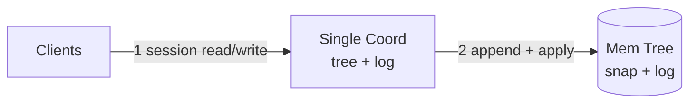
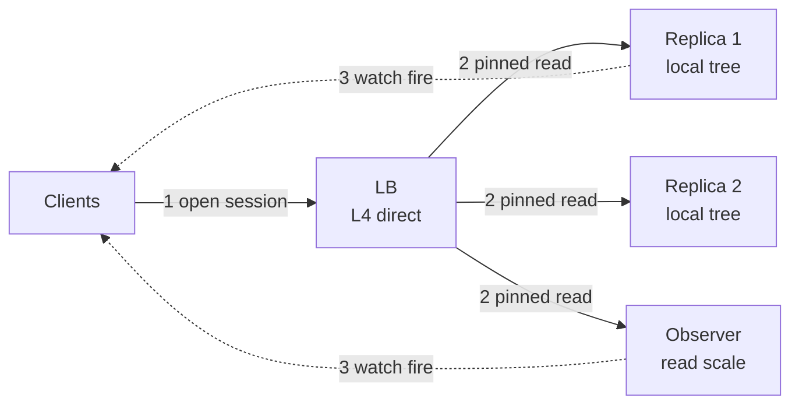
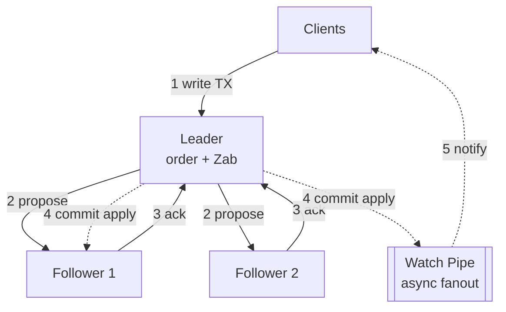
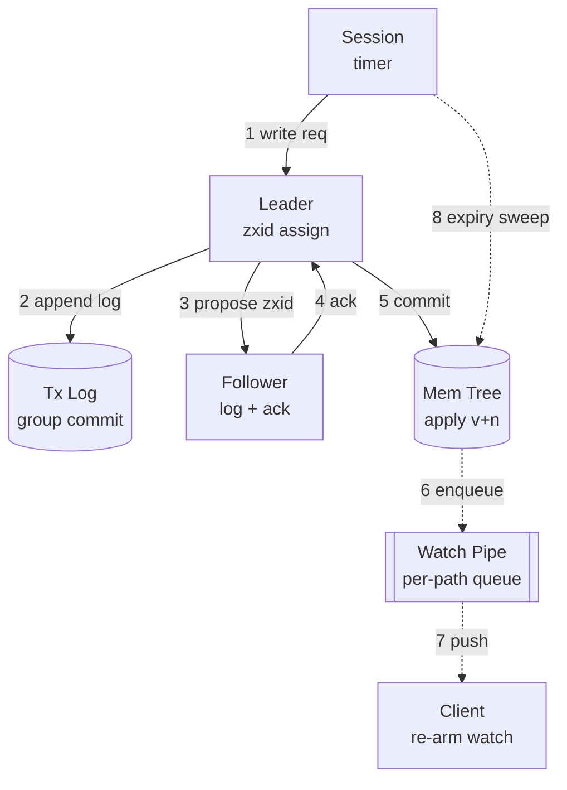
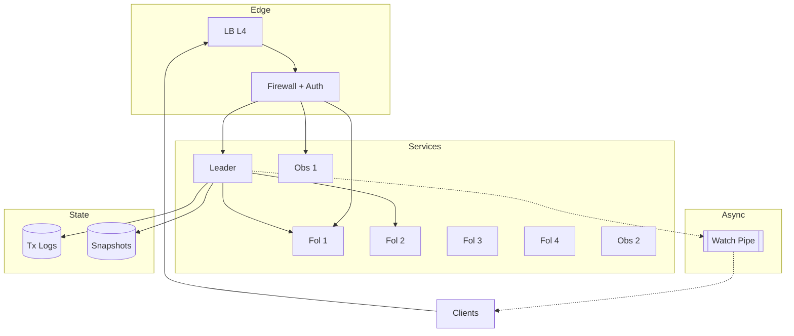

# Design: Distributed Coordinator like ZooKeeper — full HLD + LLD (staged, agnostic)

- Slice: `--full`
- Scope line: design a strongly-consistent coordination service for service fleets at 100k sessions, 200k read QPS (queries per second: requests arriving each second) peak and 4k write QPS (queries per second: requests arriving each second) peak, strong linearizable writes and watch-ordered reads.
- > Archetype: hybrid: transactional core plus live fan-out — because linearizable writes with global order dominate correctness first, then watch-trigger fan-out to waiting clients dominates scale.

## Step 0 — Assumptions (FR / NFR / out-of-scope)

One-sentence restatement: you get a tiny filesystem-like tree where services stash small configs, elect a leader, and learn instantly when anything changes. Here is the first principle that carries everything: coordination is valuable precisely because everyone agrees, so you pay for agreement on writes and stay cheap on reads.

| Question | Assumption (prefix `Assumption:` if unconfirmed) | Why it drives the design |
|---|---|---|
| FR (functional requirements: what the system does, verb-first) | 1. `Assumption:` create, read, write and delete znodes (filesystem-like data nodes addressed by path) 2. `Assumption:` watch a path and receive one-shot change notice 3. `Assumption:` hold ephemeral plus sequential nodes tied to a session 4. `Assumption:` run leader-election and lock recipes on sequential nodes | Names the journey the design lives or dies by; every box traces to ordered writes plus watch delivery |
| Scale horizon | `Assumption:` 100k concurrent client sessions, 1M active watches, 10M live znodes, growth 2x per year, peak factor 2.0 | Decides ensemble size, RAM, watch fan-out budget |
| Read:write + payload | `Assumption:` 98 reads to 2 writes, znode data avg 1KB plus path 100B, heartbeat every 10s, retention of log 24h plus snapshots | Splits local-read path from quorum-write path |
| Latency / availability | `Assumption:` p99 (99th-percentile latency: near-worst case almost every request beats) write below 20ms intra-DC (single datacenter: machines in one building), p99 read below 5ms local, 99.95% (uptime share: about 22 min downtime a month) writes, 99.9% reads | Bans cross-region sync writes from hot path; sets degrade bar to stale reads over errors |
| Consistency / durability | Linearizable writes globally ordered by zxid (transaction id: globally ordered write stamp); reads by default from local replica with watch-order guarantee, optional sync read; RPO (recovery-point objective: how much recent data you may lose) zero on quorum-committed writes | Splits CP (consistent-under-partition: rejects minority writes to protect truth) write core from best-effort watch fan-out |
| Out-of-scope (3–5) | 1. Large blobs or file storage 2. Full-text search over data 3. Multi-tenant billing and per-key ACL (access control list: who may read or write) service 4. Cross-region active-active writes 5. General pub-sub streaming | Deferred with forcing condition: add blob store when values exceed 1MB; add cross-region writes when two regions must both accept writes |

Scope method follows `requirements-scoping`: three lists — FR (functional requirements: what the system does), NFR (non-functional requirements: how fast, how reliable, at what scale) — plus revisable `Assumption:` lines, no silent facts. Write the guesses down. You will argue with them later, and that is the point.

## Step 1 — Naive v1 + mermaid #1 (≤3 nodes, archetype-shaped)

Archetype: transactional core, so v1 is Clients to one coordinator to one durable log. One box can never disagree with itself. That is why you start here. You get atomic compare-and-set for free, and you learn the real access shape before paying for agreement.

- Why starting simple is correct: (a) single process gives linearizable order with zero election and zero quorum (majority vote between copies) trips, satisfying FR at small scale; (b) ephemeral nodes are just session-keyed entries reaped on disconnect, no fencing yet; (c) single-node throughput and RAM are the BOTEC (back-of-the-envelope calculation: rough sizing math that decides the shape) baseline before an ensemble.
- Deliberately deferred: ensemble replication until availability NFR forces it; observers until read QPS (queries per second: requests arriving each second) exceeds one box; hierarchical sharding until 10M znodes outgrow RAM; cross-region until a region-loss requirement appears. Do not build what no number asks for yet.

## Step 2 — BOTEC break-table (only chains that can change a decision)

Formulas: `QPS_avg = sessions x ops_per_session_per_sec`; `QPS_peak = avg x peak_factor (how many times busier the busiest second is than average)`; `storage_live = znodes x bytes_per_znode`; `bandwidth = QPS x payload`; `servers ≈ peak ÷ per-server_QPS (requests one box handles per second)` (KV node about 10k, cache 100k to 1M per `back-of-the-envelope`). Exact chains checked by hand below with inputs, math, and units on every row.

| Load | Math (inputs + units) | Verdict (breaks what / forces what) |
|---|---|---|
| Read avg | 100,000 sessions x 1.0 reads per s = **100,000 reads per s avg** | Single box strained; forces local-replica reads |
| Read peak | 100,000 reads per s x 2.0 peak_factor = **200,000 reads per s peak** | Breaks single-node serve; forces 5-voter ensemble plus observers (verdict V-read) |
| Write avg | 100,000 sessions x 0.02 writes per s = **2,000 writes per s avg** | Fits one ordered log; no sharding yet |
| Write peak | 2,000 writes per s x 2.0 = **4,000 writes per s peak** | Forces single-leader ordering with quorum acks; single RDBMS (relational database: tables with joins) at about 1k would break, in-memory quorum survives (verdict V-write) |
| Heartbeats | 100,000 sessions ÷ 10 s per heartbeat = **10,000 heartbeats per s** | Forces connection pinning plus session-timeout triage, not a store read per beat |
| Live state | 10,000,000 znodes x 1,124B per entry = 1.124e10 B ≈ **11.2 GB RAM live** | Fits RAM of one box with snapshot; no sharding (verdict V-cap) |
| Log bandwidth | 4,000 writes per s peak x 1,124B = 4.496e6 B per s ≈ **4.5 MB per s** | Trivial for disk sequential append; forces group-commit batching only |
| Watch fan-out burst | 4,000 writes per s x 100 watchers per hot path = **400,000 notifications per s burst** | Breaks inline delivery on write path; forces async watch pipeline with backpressure (verdict V-watch) |
| Read servers | 200,000 reads per s peak ÷ 40,000 reads per s per replica = **5.0 → 5 replicas** | Deciding verdict: 5 voters for writes plus 2 to 4 observers for read headroom |

Conclusion: V-write forces a 5-node quorum with a single leader for total order, V-read forces local reads plus observers, V-cap confirms 11.2 GB fits memory so no sharding, and V-watch forces watches off the commit path. Single-node v1 holds until writes need survival of one box loss or reads pass about 40k per s. Skipped: cross-region bandwidth and long-retention analytics — YAGNI (you are not gonna need it: do not build what no number forces) with one region named and 24h log retention.

## Step 3 — API / interface contracts (LLD surface)

Per `api-design`: one binary session protocol over persistent TCP (transmission control protocol: reliable ordered connection), verbs by retry safety, version-checked writes for safe retries, cursor-free watches with one-shot semantics, stable error envelope, `/v1` naming for admin REST (representational state transfer: resource CRUD over HTTP). The contract is what recipes marry, so read this before the boxes. Every endpoint below ties to one FR.

- `create(path, data, ephemeral, sequential)` → 201 `{path_actual, version:0, zxid}` — unsafe write, client supplies client-generated request id for dedupe; replay with same id returns stored path instead of a duplicate sequential node. Serves FR-1 plus FR-3. Rationale: sequential election depends on exactly-once creation.
- `getData(path, watch_flag)` → 200 `{data, version, zxid, watch_set:true}` — retry-safe idempotent (safe to repeat: twice changes nothing) read served locally; watch fires once then client must re-arm. Serves FR-1 plus FR-2. Rationale: cacheable locally with order bound.
- `setData(path, data, version)` → 200 `{version_new, zxid}` or 409 on version mismatch — conditional write, retry only with fresh version. Serves FR-1. Rationale: compare-and-set without distributed locks.
- `exists(path, watch_flag)` and `getChildren(path, watch_flag)` → 200 `{stat_or_list, watch_set:true}` — idempotent reads, follower-served. Serve FR-2. Rationale: presence and membership without write cost.
- `delete(path, version)` → 204 or 409 on version conflict or 404 on missing — idempotent delete keyed on version. Serves FR-1. Rationale: safe retry after timeout.
- `sync(path)` → 200 `{zxid}` — forces local replica to catch to leader before next read. Rationale: cheap linearizable read without quorum on every read.
- Session: `createSession(timeout_s)` with heartbeats; expiry deletes ephemeral nodes and fires watches. Errors: `{code, message, request_id, retryable}` plus 429 with Retry-After on overload, 409 version conflict, 503 quorum-unavailable. Versioning: wire protocol version negotiated at handshake plus `/v1` admin paths, additive fields only.

## Step 4 — Evolved reads HLD + mermaid #2 (≤10 nodes; Step-2 read verdict forces it)

Verdicts forcing reads: V-read at 200k per s peak plus heartbeat load. The principle never changes: reads should never wait on agreement. Serve from the nearest copy that is fresh enough, and pay for order only when the caller asks.

Per added component — **Why / Without-it / Change-when**:

- L4 LB (load balancer: spreads connections over healthy boxes) with session pinning — Why: spreads 200k reads per s plus 10k heartbeats per s across replicas without per-request routing cost, per `load-balancing` least-connections recipe for uneven session cost. Without-it: one replica melts while others idle. Change-when: TLS (transport layer security: encrypted pipe) inspection or path routing needed → move to L7.
- Voting followers serving local reads — Why: V-read cannot pay quorum per read; follower tree is in-memory and fresh within milliseconds. Without-it: leader becomes read SPOF (single point of failure: one box whose loss halts a flow). Change-when: read-your-write required → route that client via `sync` or leader read.
- Observers, non-voting replicas — Why: add read headroom without raising quorum size or election cost, per `scaling-evolution` stateless-read rung. Without-it: adding voters slows every write quorum. Change-when: observer lag exceeds watch-freshness SLO (service-level objective: the promise you measure) → promote to voter or add regions.
- Watch cache per server — Why: V-watch burst of 400k per s cannot walk the tree per fire; materialize watcher lists per path. Without-it: hot path write stalls on fan-out. Change-when: watch count exceeds RAM → paginate watchers with `distributed-logging`-style spill.

## Step 5 — Evolved writes HLD + mermaid #3 (≤10 nodes; write/durability verdict forces it)

Verdicts forcing writes: V-write at 4k peak with zero-RPO (zero loss tolerance) plus V-watch fan-out. Split the money path from the notify path. Order first, acknowledge fast, tell watchers after. That ordering is the whole correctness story.

Per added component — **Why / Without-it / Change-when**:

- Single leader with Zab (ZooKeeper atomic broadcast: leader-driven log replication protocol) total order — Why: V-write needs one global zxid order at 4k per s; leader assigns zxid and followers ack a majority, per `consistency-coordination` single-leader plus consensus recipe. Without-it: concurrent writers diverge and elections never converge. Change-when: leader CPU saturates or write region must survive region loss → partition by namespace, never multi-leader on one tree.
- Transaction log plus in-memory tree plus periodic snapshot — Why: 4.5 MB per s sequential append gives zero-RPO replay while tree stays in RAM for 5ms reads, per `data-storage` write-ahead plus checkpoint recipe keyed by path. Without-it: restart loses committed writes. Change-when: snapshot replay exceeds election timeout → shard tree or shorten snapshot interval via `task-scheduling`.
- Quorum N=5, W=3, R for writes implicit — Why: survives 2 simultaneous box losses while keeping write latency to 2 acks. Without-it: N=3 stalls on one slow plus one dead box during rolling upgrade. Change-when: 5-node cross-AZ (availability zone: isolated rack group) RTT (round-trip time: send plus reply delay) blows 20ms p99 → drop to N=3 with 2 observers.
- zxid as `sequencer` epoch plus counter — Why: 64-bit monotonic stamp gives total order and idempotency anchor without a separate ID service, per `sequencer` ticket-range lesson applied as leader-local counter. Without-it: no replay or dedupe key. Change-when: multi-tree federation → add tree-id bits to zxid.
- Async watch pipe with DLQ (dead-letter queue: parking lot for messages that always fail) for poison watchers — Why: V-watch 400k per s burst must never block commit; slow clients shed and retry, per `messaging-streaming` at-least-once plus idempotent consumer recipe. Ordering scoped to one path, never global. Without-it: one slow watcher stalls the leader. Change-when: loss-sensitive subscribers appear → add durable subscription log.

## Step 6 — LLD deep-dive + mermaid #4 (≤10 nodes, one subsystem only)

Target: Zab commit plus session-expiry plus watch-fire path, the archetype pain. Zoom in close. One write travels leader to disk to majority to memory to watchers, and every hop has a timeout so a slow box cannot hold the ensemble hostage.

- Hot-path walk with per-hop protocol plus payload bytes: client TCP frame about 1.2KB → leader assigns 8B zxid plus 8B version → group-commit batch about 64 writes or 5ms window to disk sequential 4.5 MB per s → follower append plus fsync (force data to disk) ack about 100B → leader commits once 2 acks arrive → in-memory tree apply bumping version → per-path watcher list snapshot enqueue → async TCP push about 1.2KB per watcher → client re-arms with next `getData` with watch flag. Sync reads call `sync` first, which is a leader round trip without log append.
- Key, index, TTL (time to live: auto-expire timer), partition table:

| Entity | Key | Index / knob | TTL / retention |
|---|---|---|---|
| znode | full path string, e.g. `/election/lock-0001` | in-memory hash by path plus parent-children list; version int per write | No TTL; deleted explicitly or by session expiry if ephemeral |
| session | 8B session id | owner map session to ephemeral paths; heartbeat timer wheel | Timeout `Assumption:` 30s; expiry sweep deletes owned ephemeral nodes |
| transaction | zxid epoch plus counter | sequential log file plus snapshot every 100k txns | Log 24h, snapshots kept 3 copies |
| watch | path plus session id | per-path watcher set in memory; per-server queue depth cap | One-shot; auto-removed on fire or session close |

- Failure injection: kill each box and state what you see. Kill leader → writers block 3 to 5s during election, readers keep serving locally, watches pause; recovery via Zab election needing 3 of 5 votes, clients back off with jitter (randomized spread so retries do not march together) and re-pin via LB (load balancer: spreads connections over healthy boxes). Kill follower → no user impact; leader keeps 4 of 5. Kill observer → pinned readers reconnect elsewhere. Disk stall on leader → followers time out proposal, trigger election; mitigation is separate log disk plus fsync latency SLI (service-level indicator: the metric measuring the promise). Session-expiry storm after network blip → expiry sweep batches deletes and watch pipe sheds with 429 plus Retry-After; money paths fail closed on quorum loss, reads prefer stale-partial over errors per `resilience-failure` breaker plus bulkhead recipe.
- Bottleneck metric plus signal for evolution: leader proposal latency p99 and quorum ack quorum-wait; when p99 ack exceeds 12ms sustained or watch queue depth exceeds 100k, add observers and shorten group-commit window before considering namespace split.

## Step 7 — Final topology + mermaid #5 (≤14 nodes, topology only)

No rationale on arrows. Full detail lives in Steps 4 to 6 and sections 8 to 10.

## 8. Data model / structures

Stores: every voter keeps a full in-memory tree plus its own transaction log plus snapshots, routed by `service-decomposition` single-writer boundary — one leader owns all mutation, followers own reads. You own the tree layout, so keep paths shallow and fan-out wide.

- znode row: `path` primary key with hash sharding deferred, `data` up to `Assumption:` 1MB hard cap with 1KB typical, `version` int bumped per `setData`, `zxid_created` plus `zxid_modified`, `ephemeral_owner` session id or null, `sequential_suffix` 10-digit for election queues. Index per hot query: path hash for point reads, parent-path prefix scan for `getChildren`, owner-session secondary map for expiry sweeps.
- session table in memory: `session_id`, `timeout_s`, `last_heartbeat_ms`, owned ephemeral path list. Heartbeat updates are timer-wheel touches, never log appends.
- log record: `{zxid, txn_type, path, data, version_check}` sequential bytes, fsync per group-commit batch. Snapshot: serialized tree every `Assumption:` 100k transactions, retained 3 copies plus 24h log for replay.
- Why this shape: path-keyed tree makes election recipes trivial — lowest sequential child wins — while version-checked writes give compare-and-set without a lock service. Per `data-storage` cheap-first rule you stay on one in-memory dataset until V-cap breaks; sharding is the last rung, not the first.
- `dns` (domain-name lookup: hostname to address) is one line: clients resolve the ensemble via DNS with 30s TTL (time to live: auto-expire timer) plus LB health-gating, never direct IP pinning.

## 9. Key decisions & trade-offs

| Decision | Solves (cite FR/NFR/verdict) | Worsens (non-empty, blocking) | Change it when (breaking point) |
|---|---|---|---|
| 5-voter Zab ensemble with single leader | V-write 4k ordered writes with zero RPO; FR election needs total order | Write latency pays 1 follower RTT plus fsync; leader CPU is the write ceiling; ops must run quorum carefully | Leader proposal p99 exceeds 12ms sustained or voters exceed 7 → split namespace or add observers instead |
| Follower-local reads plus optional sync | V-read 200k peak at 5ms p99; keeps leader free for writes | Reads may lag leader by milliseconds; read-your-write needs extra round trip | Freshness SLO tightens to linearizable-everywhere → force quorum reads and pay 3x latency |
| One-shot watches with async fan-out | FR-2 presence at 400k burst without blocking commit | Client must re-arm and may miss intermediate states; slow consumers get dropped | Clients demand lossless event history → add durable per-client event log |
| Ephemeral nodes tied to session | FR-3 membership plus failure detection without heartbeats per key | Expiry storms after partition delete thousands at once; session tuning is subtle | Membership churn exceeds 10k expiries per s → move presence to lease-heartbeat store |
| In-memory tree plus log plus snapshot, no external DB | 11.2 GB fits RAM; 4.5 MB per s log is trivial; avoids DB hop | Full dataset must fit one box RAM; snapshot load pauses apply briefly | Dataset exceeds 70% RAM or snapshot replay exceeds election timeout → federate by subtree |
| Observers for read scale, not more voters | Adds 40k reads per s each without slowing quorum | Observers lag further and cannot vote; client routing must know voter versus observer | Observer lag breaks watch SLO → promote to voter or regional ensemble |
| Group-commit batching 5ms or 64 txns | Turns 4k fsyncs per s into about 200 batch fsyncs; protects p99 | Adds up to 5ms commit tail; tiny single-write latency slightly worse | p99 write budget drops below 10ms → shrink batch or use faster log disk |
| N=5 not N=3 | Survives 2 simultaneous failures plus 1 rolling-upgrade node | 2 extra boxes plus quorum needs 3 acks not 2 | Cross-AZ RTT blows 20ms p99 → drop to N=3 plus observers |

## 10. Failure modes & degradation

| Failure | User sees | Degrade path | Recovery (no stampede) |
|---|---|---|---|
| Leader crash | Writes stall 3 to 5s; reads fine | Readers stay on followers; writers get retryable 503 with Retry-After | Election needs 3 of 5 votes; clients jitter reconnect; LB slow-starts new leader |
| Quorum loss, 3 of 5 down | Writes rejected, reads served stale with flag | Fail closed on writes to protect order; reads marked stale:true | Rebuild from snapshot plus log replay; admit traffic trickle-first |
| Follower lag beyond 1k txns | Stale reads on pinned sessions | Route read-your-write clients via sync or leader; expose lag SLI | Catch-up via snapshot diff then incremental; no full reconnect storm |
| Session-expiry storm after blip | Mass ephemeral deletes plus watch flood | Batch expiry sweeps; watch pipe sheds lowest-priority pushes with 429 | Jittered client re-create; expiry rate-limiter per `resilience-failure` token bucket |
| Watch-herd on hot path | 400k pushes per s burst | Per-path queue with cap plus coalescing (merging duplicate notices into one); drop plus re-arm signal | Drain queue by priority; observers absorb fan-out |
| Disk stall on leader log | Proposal timeouts, election triggered | Fail over to fresh leader; old leader rejoins as follower after fsync probe | Separate log disk; fsync-latency alert pages before stall cascades |
| Observer overload | Slow reads on that node | LB (load balancer: spreads connections over healthy boxes) evicts node after 3 failed health checks; sessions re-pin | Warm caches before re-admit; readiness not liveness gates return |
| Clock skew across voters | False session expiries | Monotonic server clock for timeouts, never wall time for ordering; zxid is leader counter | NTP (network time protocol: clock-sync service) skew alert; fence skewed node from leadership |

## 11. Scale evolution (10× / 100×)

Current bottleneck plus signals: the leader orders every write, so watch `proposal_p99_ms` and `quorum_ack_ms` and `watch_queue_depth`. Today 4k writes is comfortable. That is your ceiling to stare at.

- At 10x (40k writes per s, 2M reads per s): leader CPU and log fsync saturate first. Add 4 to 8 observers for reads, shrink group-commit, separate log NIC (network card: physical network port) and disk, lengthen snapshot cadence with background snapshots via `task-scheduling` cleanup jobs. If one hot subtree causes most writes, federate by subtree — `/locks` versus `/config` on separate ensembles — per `scaling-evolution` federation rung. Signal it is time: proposal p99 above 12ms for 10 minutes or fsync p99 above 8ms.
- At 100x (400k writes per s): a single ordered log cannot hold it, full stop. Split into cell-based ensembles per tenant or per subtree with a thin routing tier, move high-churn presence out of the strongly-consistent tree into a lease store, and front hot config reads with client-side cache plus version polling. Cross-region stays async with one primary writer per cell; multi-writer on one path is explicitly refused. Signal: single-ensemble write CPU above 70% after observer offload, or dataset above 100 GB RAM.
- What never changes: writes stay CP (consistent-under-partition: minority rejects writes) with minority rejection on partition, per `consistency-coordination` partition rule. You scale by adding cells, not by weakening order.

## 12. Open questions + validation

Open: confirm 100k sessions versus DAU (daily active users: distinct humans per day) counting; confirm 30s session timeout versus 10s heartbeat; deferred blocks — media explicitly deferred (znode cap 1MB, larger blobs belong in `blob-store` with pointer znode); search explicitly deferred (prefix scans only, full-text belongs in `distributed-search`); IDs (identifier scheme) covered by zxid via `sequencer` leader counter, no separate service; logs shipped via `distributed-logging` file-to-collector pipeline off the write path; SLOs (service-level objectives: promises you measure) plus dashboards owned by `observability` with RED (rate-errors-duration: request health triple) on session ops plus USE (utilization-saturation-errors: resource health triple) on log disk; scheduled snapshot plus expiry sweeps owned by `task-scheduling`; hot-path counters kept local with `sharded-counters` only if per-path stats exceed one box.

- [ ] Every §9 row has non-empty Worsens + breaking point.
- [ ] Every number carries inputs + units; skipped chains justified (YAGNI).
- [ ] Every component traces to an FR, NFR, or Step-2 verdict (else deleted).
- [ ] Every critical dependency has a degrade path (not just "retry"); money paths fail closed.
- [ ] Mermaid caps hold (10 / 10 / 10 / 10 / 14); arrows numbered sync solid, async dashed.
- [ ] Coverage sweep: media / IDs / search / logs / SLOs / jobs / counters addressed or explicitly deferred.
- [ ] No managed-service names/quotas unless user named a cloud (then "verify against current docs").
- [ ] Weakest dimension + current bottleneck + next-magnitude change stated; never claims perfection.

Weakest dimension: single-leader write ceiling plus session-expiry coupling — a hot election queue plus a network blip can briefly stall all writes. Current bottleneck: leader proposal plus quorum ack at 4k writes. Next-magnitude change: observers now, subtree federation at 10x.
