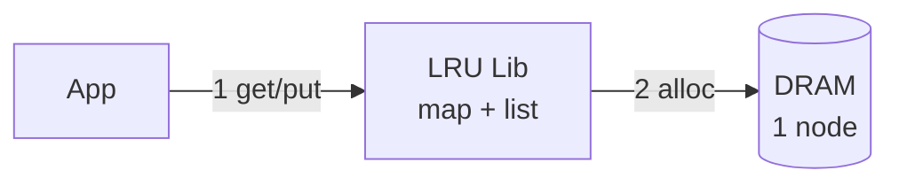
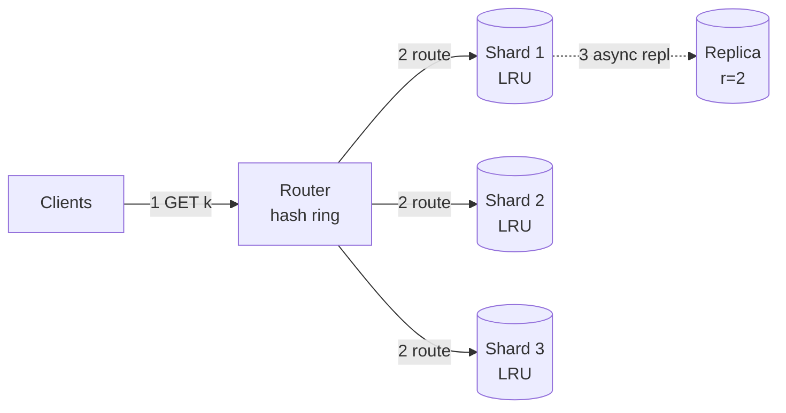
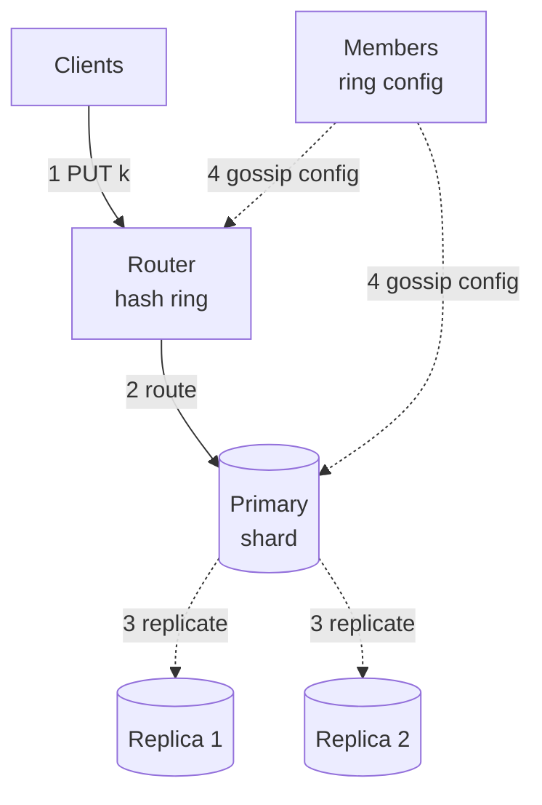
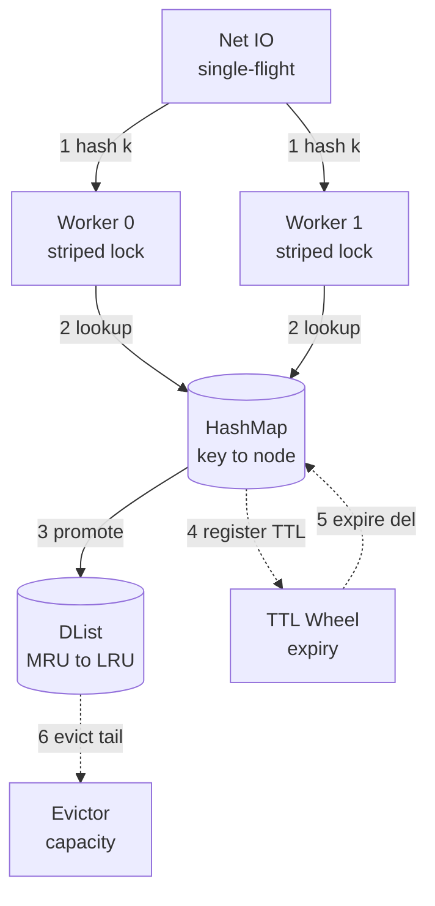
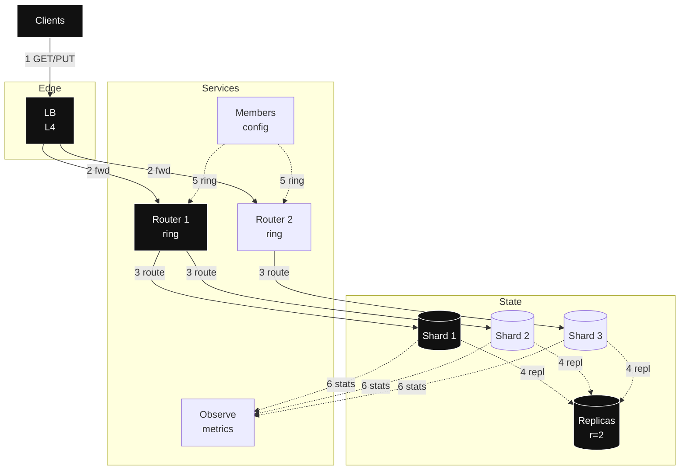

# Design: LRU Distributed Cache — full HLD + LLD (staged, agnostic)

- Slice: `--full`
- Scope line: you are building a distributed LRU (least recently used: drop what was touched longest ago) cache at 1M+ QPS / 1B keys. Each box tracks its own order. Copies catch up soon, not instantly.
- > Archetype: single box → many boxes for reads — traffic × size decides first, then sharding + background copies decide.

## Step 0 — Assumptions (FR / NFR / out-of-scope)

In one line: shared memory pool where apps stash bytes by key, each with a TTL (expiry timer). Each box drops its own oldest.

| Question | Assumption (prefix `Assumption:` if unconfirmed) | Why it drives the design |
|---|---|---|
| FR (2–4 core flows, verb-first) | 1. `Assumption:` GET key → value or miss 2. `Assumption:` PUT key with value + TTL 3. `Assumption:` DELETE key 4. `Assumption:` subscribe to ring/membership version | Names the journey the design lives or dies by; every box traces to GET/PUT |
| Scale horizon | `Assumption:` 50M DAU × 2000 ops/user/day = 1.16M avg, peak factor 2.0 → 2.3M peak; 1B live keys × ~1KB; growth 2×/yr | Decides shard count, RAM, router tier |
| Read:write + payload | `Assumption:` 90% GET / 10% PUT, value ~1KB + ~100B overhead, TTL default 1h with jitter | Splits single-flight/hot-key (reads) vs replicate/evict (writes) |
| Latency / availability | `Assumption:` p99 GET <5ms intra-DC, PUT <10ms; 99.9% GET success; client fail-open to origin on cache down | Bans cross-region sync and durable TX from hot path; sets degrade bar |
| Consistency / durability | Ephemeral DRAM, eventual cross-replica, per-key last-write-wins; RPO = lose un-replicated window OK | Splits cheap eventual cache from any strongly-consistent store (out of scope) |
| Out-of-scope (3–5) | 1. Origin database / source of truth 2. Cross-region strong replication 3. Large blobs / streaming media 4. Full-text search over values 5. Per-key ACLs / billing | Deferred with forcing condition: add origin adapter when miss-penalty SLO forces it; add cross-region when multi-DC NFR appears |

We follow `requirements-scoping`: FR (what it does), NFR (how well), plus revisable `Assumption:` lines. No hidden facts.

## Step 1 — Naive v1 + mermaid #1 (≤3 nodes, archetype-shaped)

Start with one box: HashMap + linked list in memory, no network. First principle: no coordination is fastest. One box can't disagree with itself.

- Why simple works: one box needs no agreement, GET/PUT are local, and it sets our speed baseline.
- Deliberately deferred: router, copies, disk save, and request merging — until numbers force them.

## Step 2 — BOTEC break-table (only chains that can change a decision)

Formulas: `QPS_avg = DAU (daily active users) × actions/day ÷ 86,400`; `QPS_peak = avg × peak_factor (how many times busier the busiest second is than average)`; `live_bytes = live_keys × (value+overhead)`; `bandwidth = QPS × payload`; `servers ≈ peak ÷ per-server_QPS (requests one box handles per second)` (cache ~100k–1M per `back-of-the-envelope`). Check via `skills/back-of-the-envelope/scripts/botec.py`. Every row shows inputs → math → units.

| Load | Math (inputs + units) | Verdict (breaks what / forces what) |
|---|---|---|
| Total ops avg | 50M users × 2000 ops/user/day ÷ 86,400 s/day = 100,000M ÷ 86,400 ≈ 1,157,407 ops/s ≈ **1.16M QPS avg** | Confirms high-scale; single node dead |
| Total ops peak | 1,157,407 QPS × 2.0 peak_factor = **2,314,815 QPS peak ≈ 2.3M** (`botec.py --dau 50e6 --actions 2000 --peak 2` → avg 1.2M / peak 2.3M) | Forces router + sharded fleet; LB + routers sized to 2.3M |
| GET peak | 2.3M × 0.90 read_ratio = **~2.08M GET/s peak** | Forces per-shard QPS budget + hot-key replication + single-flight |
| PUT peak | 2.3M × 0.10 = **~231k PUT/s peak** | Fits sharded DRAM writes; no WAL/queue needed (ephemeral) |
| Live capacity | 1B keys × (1024B + 100B overhead) = 1B × 1124B = 1.124e12 B ≈ **1.12 TB RAM live** | Breaks single box; forces sharding (verdict V-cap) |
| With replicas | 1.12 TB × 3 copies (1 primary + 2 replicas) = **~3.36 TB RAM cluster** | Forces ~30+ nodes by RAM even though QPS needs only ~12 |
| QPS servers | 2.3M peak ÷ 200k QPS/node = **11.5 → 12 nodes** (`--server-qps 200000` → 12) | QPS floor = 12; RAM ceiling dominates → provision by RAM |
| RAM servers | 3.36 TB ÷ 0.10 TB usable-data/node (128GB box, ~100GB for cache data after OS/overhead) → 3.36 ÷ 0.10 = **33.6 → 34 nodes**; round to **12 primaries × 3 copies = 36 physical nodes** (+2 spare = 38 provisioned) | **Deciding verdict:** provision 12 primary shards, 36 physical nodes; QPS headroom free |
| Bandwidth egress | 2.08M GET/s × 1024B = 2.13e9 B/s ≈ **2.1 GB/s** (+miss/PUT ≈ 2.4 GB/s per `botec.py`) | Fits intra-DC NICs; skip CDN/edge (values small, not static web) |
| Churn / eviction | `Assumption:` TTL 3600s → expiry rate ≈ 1B ÷ 3600 ≈ **278k expires/s** steady | Forces O(1) TTL wheel + sampled LRU, not scan; forces jitter |

Conclusion: 1.12 TB live / 3.36 TB with copies + 2.3M peak → 12 primaries / 36 nodes. QPS alone needs 12. Load ≈ 64k /box, ≈ 192k /primary — fits budget. Single box holds until RAM or ~200k QPS breaks it. Skip cross-region, long storage, per-row TX — no numbers force them.

## Step 3 — API / interface contracts (LLD surface)

We use `api-design`: REST/JSON, safe verbs for retries, `/v1`. Clients live with this contract, so shapes are exact.

- `GET /v1/cache/{key}` → 200 `{value_b64, version, ttl_left_s, stale:false}` / 404 miss — safe to retry. Serves FR-1.
- `PUT /v1/cache/{key}` `{"value_b64":"…","ttl_s":3600}` → 200 `{version}` — last-write-wins, so retries are safe. Serves FR-2.
- `DELETE /v1/cache/{key}` → 204 / 404 — leaves a short delete marker so slow copies learn it. Serves FR-3.
- `GET /v1/cache/_scan?cursor=…&limit=100` (ops only) — never offset. Kept off the fast path.
- Errors: `{error:{code,message,request_id,retryable}}` + `429` + `Retry-After`, `404` miss, `503` no-shard. `/v1` + new fields only.
- Key contract: `namespace:version:key` e.g. `sess:v2:abc123`; max key 256B, max value 1MB; TTL + ±10% spread.

## Step 4 — Evolved reads HLD + mermaid #2 (≤10 nodes; Step-2 read verdict forces it)

Reads hit 2.08M/s. Each GET goes to one shard. Rule: reads never wait — route to owner, copy in background.

Per added component — why it exists:

- Router (hash ring in client lib) — Why: finds shard with no lookup at 2.3M QPS. Without it: extra hops + hotspots. Change when: churn >1%/min → cache ring in proxy.
- Sharded nodes (12 × 3 = 36) — Why: 1.12 TB can't fit one box. Without them: OOM. Change when: >150k QPS or >80% RAM → split.
- Copies r=3 — Why: survive box loss, serve stale. Without them: 1/12 keys miss on crash. Change when: loss budget tightens → sync writes.
- Single-flight + spread TTL + remember misses — Why: stops hot-key stampedes. Without it: one expiry spikes origin. Change when: wait > budget → shed + serve stale.

## Step 5 — Evolved writes HLD + mermaid #3 (≤10 nodes; write/durability verdict forces it)

Writes hit 231k/s + 278k expiries/s. Rule: a cache write may be lossy. That's what makes it fast.

- Key `h(key)` picks one primary for even spread. Hot celebrity key → copy it to many nodes + tiny client cache.
- Primary copies to 2 replicas in background, last write wins. No waiting for all. Need less loss → wait for 2.
- Membership by gossip + versioned ring. Only ~K/N keys move on change. Gossip too slow → central config.
- No queue / saga on PUT — one key, retry is enough. Add stream only if write-behind appears.

## Step 6 — LLD deep-dive + mermaid #4 (≤10 nodes, one subsystem only)

Target: eviction + concurrency + expiry. Zoom in: one box must stay fast, threads must not block, old entries must die cheap.

- Hot path: `GET k` → hash → worker → map lookup → move to front, return ~1KB. Miss: merge duplicate waits, fetch once. `PUT` → insert + front + set expiry slot. Full? Drop tail.
- Key/index/TTL/partition table (fields + locks + expiry).

| Field | Value / knob | Why |
|---|---|---|
| Key | `ns:v:key`, ≤256B, hash `h=xxhash64` | Even shard + stripe spread |
| Value | opaque ≤1MB, stored + refcount | Keeps node simple; large → reject |
| LRU node | `{key, value_ptr, prev, next, expire_at, version}` | O(1) promote/evict |
| Stripes | 128 locks/node, each guards HashMap shard + its DList segment | Contention ≈ QPS/128; no global lock |
| TTL wheel | 3600 buckets (1s) + jitter ±10%, lazy expire on access + tick | 278k expires/s without scan |
| Eviction | sampled approximate-LRU (`allkeys-lru`-style) + `volatile-ttl` assist | O(1) amortized; exact global LRU banned (coordination cost) |
| Version | `lamport_ts + node_id` LWW | Idempotent replay, replica converge |

- If a box dies: retry on copy, warm empty box slowly, never let expiry scans block. Shed with `429`, never OOM.
- Watch: `hit_ratio`, `eviction_rate`, `p99_lookup`, lock wait. Act when hit <90% or lock wait high.

Applies `caching` for eviction, `data-storage` for sharding, `consistency-coordination` for background copies.

## Step 7 — Final topology + mermaid #5 (≤14 nodes, topology only)

No rationale on arrows. Full detail lives in Steps 4–6 and §8–§10.

## 8. Data model / structures

Three questions only: what is the key, who owns it, when does it die.

- Live entry: `key → {value ≤1MB, version, expire_at}`. Owner = `h(key)` → shard. Point lookups only.
- Shard map: hash ring, 100–200 spots per box. Clients cache ring, refresh every 5s.
- Expiry: default 3600s ±10%, misses remembered 5s, deletes 1s. Copies compare hashes every 30s.
- Save: none. Restart = empty + warm from copies. Add disk save only if restart loss hurts.
- Use Memcached-style striped LRU per `caching/references/providers/generic.md`.

## 9. Key decisions & trade-offs

Each row is a trade: gain, pain, when to change.

| Decision | Solves (cite FR/NFR/verdict) | Worsens (non-empty, blocking) | Change it when (breaking point) |
|---|---|---|---|
| Approximate sharded LRU (not global) | V-cap 1.12 TB + 2.3M peak; keeps O(1) evict, no cross-node lock (FR-1/2) | Loses global recency: cold shard may evict hotter-than-elsewhere key; hit_ratio 2–5% below ideal | Global hit optimality worth quorum cost (hit <85% due to skew (uneven load)) → central tracker or LFU (least frequently used: evict the rarely asked) assist |
| Consistent-hash routing (client/lib + stateless routers) | 2.3M QPS without lookup SPOF; ~K/N remap (NFR p99, V-QPS) | Ring churn + version skew causes transient misroutes; client lib complexity | Misroute >0.1% sustained → proxy-tier authoritative routing |
| Async primary→2 replicas, LWW eventual | 231k PUT/s <10ms + 99.9% (NFR); no quorum latency | Loss window on primary crash (un-replicated PUTs); stale reads during lag | Loss/stale budget tightens → W=2 sync or read-from-primary |
| Striped locks (128) + TTL wheel + single-flight | 278k expires/s + 2M GET/s per-node concurrency (parallel progress); herd guard (FR-1) | More code paths; single-flight wait adds tail if fetch slow; wheel tick CPU | `lock_wait >200µs` or single-flight wait >p99 → more stripes / shed |
| Ephemeral DRAM, no persistence | p99 <5ms, no fsync (force-write-to-disk per write) /compact stalls; cheapest for TTL data (NFR) | Cold restart = miss storm; cannot serve as source of truth | Restart-loss causes origin outage → add snapshot/WAL (write-ahead log: disk diary before answering) or warm pool |
| L4 (transport layer: routes by address, never looks inside) LB + stateless routers (no L7 (application layer: reads requests, costlier per packet) per-key logic at LB) | Cheap 2.3M fwd, routers scale horizontally (`load-balancing` L4 for raw Tput (throughput)) | No content-aware shedding at LB; hot key still hits one shard | Need per-key shed/header routing → add L7 (pay CPU/latency) |
| Fail-open (on failure keep serving, slower or staler) to origin/stale on cache down | Availability 99.9%: user sees slower/stale not error (`resilience-failure` degrade (planned worse-but-useful answer)) | Masks cache outage; origin must absorb fallback load | Origin cannot absorb → fail-closed (on failure refuse rather than risk wrong answers) + `429` to protect origin |
| Small gateway (auth (who are you) / validate / `429`) not full BFF (backend-for-frontend: custom middle layer per client type) | Keeps service granularity (how big each service is) coarse per `service-decomposition` (one cache service, no micro-fanout (splintering into chatty tiny services)) | Gateway becomes SPOF / bottleneck if it accretes logic | Gateway p99 >2ms or logic creep → split thin LB from control plane |

## 10. Failure modes & degradation

Mindset: all of this will happen. Users should not notice.

| Failure | User sees | Degrade path | Recovery (no stampede) |
|---|---|---|---|
| Single physical node crash (1/36; key-range ~1/12) | ~3% keys miss on primary, served stale from replica, p99 +2ms | Router fails to replica (stale `stale:true` allowed); `GET` coalesced | Gossip removes node, ~K/N remap; slow-start ramp + warm from replica; jittered reconnect |
| Two replicas + primary down (shard dark) | Miss for that range | Fail-open to origin if present else `404` + `retryable:false`; shed PUTs with `429` | Rebuild empty shard, admit trickle via half-open breaker (probe state letting a few requests through to test recovery), single-flight caps origin QPS |
| Hot key >1 shard QPS | Elevated p99 on that key | Replicate hot key to N nodes + L1 in lib; coalesce | Alert on per-key QPS; auto-replicate threshold; drop L1 after cool |
| Mass expiry / cold restart | Hit_ratio crater, origin surge | TTL jitter + early probabilistic refresh; warm top-K from replica snapshot | Ramp traffic, cap prefill QPS, breaker on origin |
| Router/ring skew | Transient misroute 404s | Versioned ring + retry on adjacent node (1 extra hop budget) | Poll `CF` 5s + gossip; alert on misroute rate |
| LB loss | Conn drop | Active-active LBs + anycast VIP (one address announced from many sites, network picks nearest) failover | Drain + connection limits; thundering reconnect with jitter |
| Config quorum loss (members) | No membership change (reads/writes continue on last ring) | Freeze ring, read-only mode for topology | Majority restore; no data-plane freeze |
| Penetration (missing-key flood) | Higher shard CPU | Negative cache 5s + Bloom (Bloom filter: tiny probably-seen set, never misses a true seen, sometimes false-alarms) in lib | Rate-limit per client (`429+Retry-After`) |

Fit in 5ms: 1ms client→router + 2ms router→shard + 1ms work + 1ms slack. Retry GET/PUT max 2 with spread. Open breaker at 50% errors/10s.

## 11. Scale evolution (10× / 100×)

RAM fills before QPS. Watch `ram_used`, `hit_ratio`, `eviction_rate`, `p99_GET`.

- 10× (≈23M peak, 10B keys, ~11 TB live / 33 TB with r=3): split shards to ~120 primaries / ~360 physical by consistent-hash add (only ~K/N move); add L1 in-process in client lib for top-0.1% hot keys; isolate hot-key replicas; move `Members` to dedicated quorum (3–5 nodes); add per-tenant rate limits. Signal to act: `per-primary QPS >150k` or `RAM >80%` for 10 min.
- 100× (≈230M peak, 100B keys): cell split by namespace/prefix (federate rings per tenant/prefix, per `data-storage` federation (split by function/domain) before further sharding); multi-DC (data center) active-active with async cross-DC replicate (eventual, LWW + version vectors (per-copy counters that reveal who saw what) for conflicts); introduce origin spillover + `blob-store` for >1MB values; add `distributed-search` only if value-query appears (else still deferred). Signal: single ring gossip >5s or cross-DC RTT (round-trip time) dominates p99.
- What metric says it is time: `hit_ratio`, `eviction_rate`, lag, ring speed. Holds until ~3 TB or ~2.5M QPS per cell. Then add cells, not bigger boxes.

## 12. Open questions + validation

Open: confirm DAU/ops (50M×2000 assumed), value-size p50 (median) /p99 (1KB assumed, 1MB cap), TTL distribution (1h assumed), origin miss-penalty SLO (fail-open assumed), namespace isolation needs, max hot-key QPS. Deferred with one-line reasons: `blob-store` (big-file storage: values ≤1MB, no media path), `distributed-search` (ranked text search: point keys only, no value query), `content-delivery` (edge CDN: intra-DC bytes, not static web), `dns` (name-to-region steering: single-DC, LB+anycast suffices), `messaging-streaming` (async queue/stream transport: PUT LWW idempotent, no stream/DLQ needed), `sequencer` (distributed ID minting: keys client-supplied, no ID gen), `task-scheduling` (cron/delayed-job leasing: expiry is wheel tick, no cron jobs), `sharded-counters` (striped hot counting: stats are sampled aggregates, no hot counters), `distributed-logging` pipeline minimal (see below).

- [x] Every §9 row has non-empty Worsens + breaking point.
- [x] Every number carries inputs + units; skipped chains justified (YAGNI (you aren't gonna need it: do not build what no number forces)).
- [x] Every component traces to an FR, NFR, or Step-2 verdict (else deleted).
- [x] Every critical dependency has a degrade path (not just "retry"); cache fail-open, no money-path to fail closed.
- [x] Mermaid caps hold (10 / 10 / 10 / 10 / 14); arrows numbered sync solid, async dashed.
- [x] Coverage sweep: media / IDs / search / logs / SLOs / jobs / counters addressed or explicitly deferred.
- [x] No managed-service names/quotas unless user named a cloud (generic only).
- [x] Weakest dimension + current bottleneck + next-magnitude change stated; never claims perfection.

Coverage: SLOs 99.9% GET <5ms, PUT <10ms, hit >90%. Watch RED (requests) + USE (resources). `livez` = restart me, `readyz` = pull me out quietly. Logs: sampled JSON with IDs, 7d. Weak spot: loss window + approximate order. Next: split shards + client cache at 10×.
