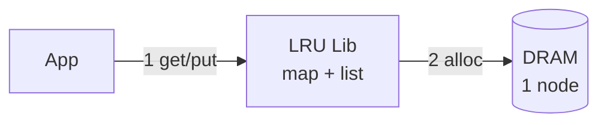
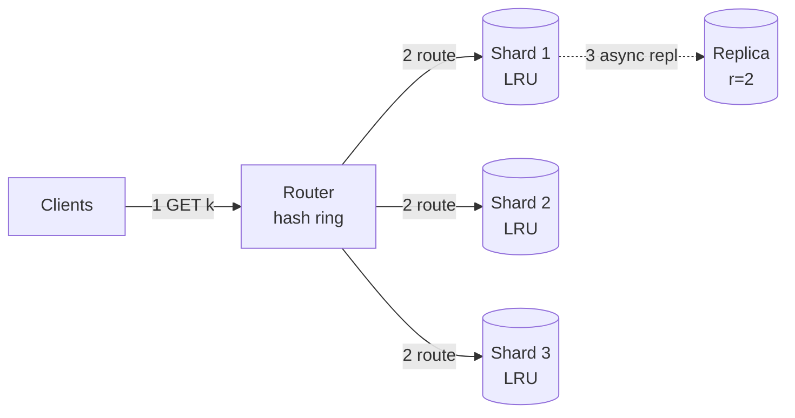
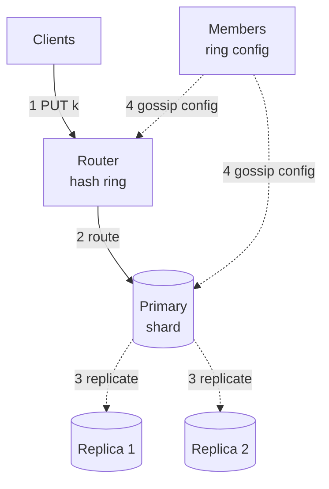
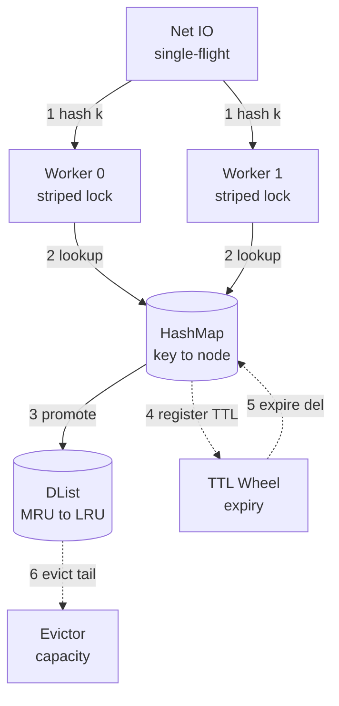
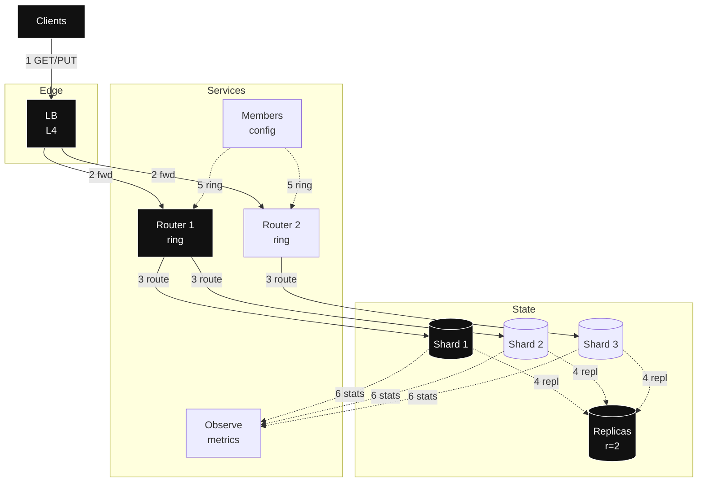

# Design: LRU Distributed Cache — full HLD + LLD (staged, agnostic)

- Slice: `--full`
- Scope line: you're building a distributed LRU (least recently used: evicts whatever was touched longest ago) cache for service fleets at 1M+ QPS (queries per second: requests arriving each second) / 1B keys. Each box keeps its own fresh-first order, and copies agree soon, not instantly.
- > Archetype: single-node stateful (all state lives in one box's memory) → distributed read-heavy serve (many boxes mostly answering reads) — because per-key ops × live capacity dominates first, then consistent-hash sharding (spreading keys around a ring so each box owns a slice) + async replication (copies sync up in the background) dominates.

## Step 0 — Assumptions (FR / NFR / out-of-scope)

One-sentence restatement: a shared DRAM (main memory: very fast, forgets everything on restart) pool where app fleets stash opaque bytes by key, each with a TTL (time to live: auto-expire timer), evicted by approximate-LRU (each box drops its own stalest entries — nobody tracks one perfect global order, because that would need constant cross-box coordination, and trust me, you don't want that bill).

| Question | Assumption (prefix `Assumption:` if unconfirmed) | Why it drives the design |
|---|---|---|
| FR (2–4 core flows, verb-first) | 1. `Assumption:` GET key → value or miss 2. `Assumption:` PUT key with value + TTL 3. `Assumption:` DELETE key 4. `Assumption:` subscribe to ring/membership version | Names the journey the design lives or dies by; every box traces to GET/PUT |
| Scale horizon | `Assumption:` 50M DAU × 2000 ops/user/day = 1.16M avg, peak factor 2.0 → 2.3M peak; 1B live keys × ~1KB; growth 2×/yr | Decides shard count, RAM, router tier |
| Read:write + payload | `Assumption:` 90% GET / 10% PUT, value ~1KB + ~100B overhead, TTL default 1h with jitter | Splits single-flight/hot-key (reads) vs replicate/evict (writes) |
| Latency / availability | `Assumption:` p99 GET <5ms intra-DC, PUT <10ms; 99.9% GET success; client fail-open to origin on cache down | Bans cross-region sync and durable TX from hot path; sets degrade bar |
| Consistency / durability | Ephemeral DRAM, eventual cross-replica, per-key last-write-wins; RPO = lose un-replicated window OK | Splits cheap eventual cache from any strongly-consistent store (out of scope) |
| Out-of-scope (3–5) | 1. Origin database / source of truth 2. Cross-region strong replication 3. Large blobs / streaming media 4. Full-text search over values 5. Per-key ACLs / billing | Deferred with forcing condition: add origin adapter when miss-penalty SLO forces it; add cross-region when multi-DC NFR appears |

Scope method follows `requirements-scoping`: three lists — FR (functional requirements: what the system does), NFR (non-functional requirements: how fast, how reliable, at what scale) — plus revisable `Assumption:` lines, no silent facts. Write the guesses down, argue with them later — that's the whole game.

## Step 1 — Naive v1 + mermaid #1 (≤3 nodes, archetype-shaped)

Archetype: single-node stateful → v1 = in-process HashMap (instant lookup table: key in, location out) + doubly-linked list (a chain you can snip and re-link in constant time, newest at the head) in DRAM, no network. Look, here's the first principle that carries this whole design: the fastest coordination is no coordination. One box can never disagree with itself, so start there — and only add boxes when memory size or request speed forces your hand.

- Why starting simple is correct: (a) single-node exact LRU satisfies FR with zero coordination and p99 (99th-percentile latency: the near-worst case almost every request beats) <1ms; (b) `PUT`+`GET` are local atomics (one indivisible step, no halfway states), no quorum (majority vote between copies) / partition (network split isolating boxes) risk; (c) capacity/QPS of one box is the BOTEC (back-of-the-envelope calculation: rough sizing math that decides the shape) baseline before sharding.
- Deliberately deferred: network router until ops exceed ~200k QPS or RAM exceeds one box; replication until 99.9% forces it; persistence until restart-loss SLO (service-level objective: the promise you measure yourself against) forces it; client single-flight (one shared backend trip for many duplicate waiting requests) until herd (thundering crowd of refills hitting at once) observed. Don't build what no number is asking for yet.

## Step 2 — BOTEC break-table (only chains that can change a decision)

Formulas: `QPS_avg = DAU (daily active users) × actions/day ÷ 86,400`; `QPS_peak = avg × peak_factor (how many times busier the busiest second is than average)`; `live_bytes = live_keys × (value+overhead)`; `bandwidth = QPS × payload`; `servers ≈ peak ÷ per-server_QPS (requests one box handles per second)` (cache ~100k–1M per `back-of-the-envelope`). Exact QPS check via `skills/back-of-the-envelope/scripts/botec.py` (see math below). Every row shows inputs → math → units, no exceptions.

| Load | Math (inputs + units) | Verdict (breaks what / forces what) |
|---|---|---|
| Total ops avg | 50M users × 2000 ops/user/day ÷ 86,400 s/day = 100,000M ÷ 86,400 ≈ 1,157,407 ops/s ≈ **1.16M QPS avg** | Confirms high-scale; single node dead |
| Total ops peak | 1,157,407 QPS × 2.0 peak_factor = **2,314,815 QPS peak ≈ 2.3M** (`botec.py --dau 50e6 --actions 2000 --peak 2` → avg 1.2M / peak 2.3M) | Forces router + sharded fleet; LB + routers sized to 2.3M |
| GET peak | 2.3M × 0.90 read_ratio = **~2.08M GET/s peak** | Forces per-shard QPS budget + hot-key replication + single-flight |
| PUT peak | 2.3M × 0.10 = **~231k PUT/s peak** | Fits sharded DRAM writes; no WAL/queue needed (ephemeral) |
| Live capacity | 1B keys × (1024B + 100B overhead) = 1B × 1124B = 1.124e12 B ≈ **1.12 TB RAM live** | Breaks single box; forces sharding (verdict V-cap) |
| With replicas | 1.12 TB × 3 copies (1 primary + 2 replicas) = **~3.36 TB RAM cluster** | Forces ~30+ nodes by RAM even though QPS needs only ~12 |
| QPS servers | 2.3M peak ÷ 200k QPS/node = **11.5 → 12 nodes** (`--server-qps 200000` → 12) | QPS floor = 12; RAM ceiling dominates → provision by RAM |
| RAM servers | 3.36 TB ÷ 0.10 TB usable-data/node (128GB box, ~100GB for cache data after OS/overhead) → 3.36 ÷ 0.10 = **33.6 → 34 nodes**; round to **12 primaries × 3 copies = 36 physical nodes** (+2 spare = 38 provisioned) | **Deciding verdict:** provision 12 primary shards, 36 physical nodes; QPS headroom free |
| Bandwidth egress | 2.08M GET/s × 1024B = 2.13e9 B/s ≈ **2.1 GB/s** (+miss/PUT ≈ 2.4 GB/s per `botec.py`) | Fits intra-DC NICs; skip CDN/edge (values small, not static web) |
| Churn / eviction | `Assumption:` TTL 3600s → expiry rate ≈ 1B ÷ 3600 ≈ **278k expires/s** steady | Forces O(1) TTL wheel + sampled LRU, not scan; forces jitter |

Conclusion, and here's the punchline: V-cap (1.12 TB live / 3.36 TB with r=3) and 2.3M peak force a consistent-hash sharded DRAM fleet of 12 primaries / 36 physical nodes; QPS alone would need only 12 physical. Effective load ≈ 2.3M ÷ 36 ≈ 64k QPS/physical (replica reads spread load) and ≈ 192k QPS/primary on primary-only writes — within cache 100k–1M budget. Single-node v1 holds until keys × bytes exceed RAM or ops exceed ~200k QPS. Skipped: cross-region bandwidth, long-retention storage, per-row TX analysis — YAGNI for ephemeral TTL cache (no origin, no regions named).

## Step 3 — API / interface contracts (LLD surface)

Per `api-design`: REST/JSON default, verbs by retry safety, `Idempotency-Key` (client-sent dedupe token: same token plus same body returns the stored answer instead of re-executing) only where needed, cursor (opaque bookmark into a sorted order, never a row offset) only for scans, stable error envelope, `/v1`. Honestly? The contract, not the boxes, is what your clients actually marry — so every shape here is written out exactly.

- `GET /v1/cache/{key}` → 200 `{value_b64, version, ttl_left_s, stale:false}` / 404 miss — retry-safe (idempotent: safe to repeat, twice changes nothing; safe to single-flight + retry). Serves FR-1.
- `PUT /v1/cache/{key}` `{"value_b64":"…","ttl_s":3600}` → 200 `{version}` — `PUT` naturally idempotent per-key LWW (last-write-wins: highest timestamp wins, no arguing); no `Idempotency-Key` needed (same key+value replay converges). Serves FR-2. Rationale: LWW keeps retries safe without dedupe table.
- `DELETE /v1/cache/{key}` → 204 / 404 — idempotent tombstone (a marker that says deleted, so slow copies learn the deletion instead of resurrecting the key) (1s) to cover replica lag (delay before copies catch up). Serves FR-3.
- `GET /v1/cache/_scan?cursor=…&limit=100` (ops only, not data path) — cursor over hash-slot, never offset. Deferred from hot path (the request flow that must stay fast).
- Errors: `{error:{code,message,request_id,retryable}}` + `429` (too many requests: back off) `+ Retry-After` (wait this long) on shed (deliberately dropping excess load), `404` miss (not error), `503` no-shard. Versioning: `/v1` URI + additive fields; binary protocol (client lib over TCP) allowed internally for p99, same semantics.
- Key contract: `namespace:version:key` e.g. `sess:v2:abc123`; max key 256B, max value `Assumption:` 1MB (larger → reject, forces `blob-store` (big-file storage) which is deferred); TTL required + jitter (randomized spread so expiries do not march in lockstep) ±10%.

## Step 4 — Evolved reads HLD + mermaid #2 (≤10 nodes; Step-2 read verdict forces it)

Verdicts forcing reads: 2.08M GET/s peak + 1.12 TB hot set (hot set: the small share of data getting most reads) + hot-key (one superstar key getting most traffic) risk. Note: each GET routes to exactly one shard; the three `route` edges below show possible destinations, not fan-out. And the principle for this whole step: reads should never wait on coordination — route straight to the owner, copy in the background.

Per added component — Why / Without-it / Change-when (cites verdict):

- Router (stateless hash-ring, client lib or sidecar (helper process beside each app)) — Why: maps `h(key)` (hash of the key: scrambled number deciding its owner) → shard without central lookup at 2.3M QPS (V-QPS). Without-it: single LB (load balancer: spreads requests over healthy boxes) fans to wrong nodes, extra hop + hotspot. Change-when: ring churn >1%/min sustained → add proxy-tier caching of ring. Uses `consistency-coordination` consistent-hash ring (owned there) in 1–2 sentences: keys+nodes share one ring, only ~K/N (your keys divided by box count: each box's fair share) remap on change, vnodes (virtual nodes: each real box claims many ring spots, which evens out load) for evenness.
- Sharded DRAM nodes (12 primaries × 3 = 36 physical) — Why: V-cap 1.12 TB cannot fit one box; shard spreads RAM+QPS (`data-storage` sharding: high-cardinality (many distinct values, so spread is even) key hash, even spread). Without-it: OOM (out of memory) + 2M QPS on one core. Change-when: per-primary >150k QPS or data-RAM >80% → split shards.
- Async replicas r=3 (1+2) — Why: 99.9% (uptime share: ~43 min downtime a month) with ephemeral (lives only in memory, gone on restart) nodes; replica serves stale on primary loss. Without-it: one primary loss = 1/12 key-range miss storm. Change-when: loss-window SLO tightens → raise to r=5 or sync quorum (pay latency).
- Single-flight (one shared backend trip for many duplicate waiting requests) + TTL jitter (randomized expiry spread) + negative cache (remembering misses briefly) in router/lib — Why: prevents herd (thundering crowd of refills hitting at once) on hot-key expiry at 2M GET/s per `caching` (coalesce (merge duplicates into one) concurrent misses, jitter ±10% stops lockstep expiry, short negative TTL stops penetration (floods of requests for keys that do not exist)). Without-it: one hot expiry → origin/shard spike. Change-when: coalesce wait >p99 budget → shed + stale-serve (answer from an older copy).

## Step 5 — Evolved writes HLD + mermaid #3 (≤10 nodes; write/durability verdict forces it)

Verdicts forcing writes: 231k PUT/s + 278k expires/s + ephemeral durability split. Writes are where people usually overbuild, so keep this in mind: a cache write is allowed to be a little lossy — that's literally what makes it fast.

- Partition key `h(key)` (hash of full `namespace:v:key`) — Why: even spread + locality (a key always living with its owner) of key to one primary (reason: spread, per `data-storage`). Without-it: hot shard melts. Change-when: celebrity key >1 shard QPS → replicate hot key read-only to N nodes + L1 (tiny private cache inside the client library).
- Async primary→replica (at-least-once delivery: retry until acknowledged, so a write may arrive twice; per-key LWW (last-write-wins) version) — Why: 231k PUT/s at <10ms cannot pay quorum (majority-ack) round trips; LWW converges (`consistency-coordination` eventual model: copies agree soon). Ordering scoped to key, never global. Retention n/a (live TTL, not log). Without-it: sync quorum doubles p99. Change-when: un-replicated loss > budget → sync W=2 (wait for 2 copies before answering).
- Membership/config (gossip (boxes swapping membership notes peer to peer in the background) + versioned ring, quorum only for membership) — Why: elastic add/remove remaps only ~K/N keys. Without-it: static N remaps all on scale (`hash%N` banned). Change-when: gossip convergence >5s → central config quorum (one majority-voted source of truth for who owns what).
- No queue/stream/DLQ (dead-letter queue: parking lot for messages that always fail) on PUT path — explicitly deferred: `messaging-streaming` queue-vs-stream not forced because PUT is idempotent LWW in-memory with no cross-service TX (transaction); replay = client retry + replica anti-entropy (both sides comparing hashes to find disagreements). Forcing condition: if origin write-behind required → add buffered stream + DLQ.
- No saga/2PC (two-phase commit: all-or-nothing vote across boxes) — deferred: single-key LWW has no multi-key atomicity; `consistency-coordination` saga/2PC inapplicable.

## Step 6 — LLD deep-dive + mermaid #4 (≤10 nodes, one subsystem only)

Target: eviction + concurrency + TTL correctness (archetype pain). Okay, zoom all the way in — inside one box the whole game is doing everything in constant time without threads tripping over each other, and letting old entries die cheaply.

- Hot-path walk (the exact steps one request travels — follow a GET with your finger): TCP/binary `GET k` (~50B key + overhead) → Net IO hashes `h(k)` → striped worker (one of 64–256 mini-queues, each with its own lock, so threads rarely wait on each other; key picks its queue by `h(k) % stripes`) → `H` O(1) (constant-time: same cost no matter how full) lookup → on hit move node to MRU (most recently used: front of the line) head O(1), return ~1KB; on miss single-flight coalesces duplicate GETs, one fetch-through (a fill trip to replica/origin whose answer is shared with all waiters) populates. `PUT k,v,ttl` → worker → insert/update `H` + MRU push + register wheel slot `now+ttl` (async: queued, not waited on); TTL expiry deletes from `H` + unlinks from `L`; capacity pressure evicts `L` tail via `E`.
- Key/index/TTL/partition table (or struct + lock table for single-node: fields, invariants, lock granularity, expiry).

| Field | Value / knob | Why |
|---|---|---|
| Key | `ns:v:key`, ≤256B, hash `h=xxhash64` | Even shard + stripe spread |
| Value | opaque ≤1MB, stored + refcount | Keeps node simple; large → reject |
| LRU node | `{key, value_ptr, prev, next, expire_at, version}` | O(1) promote/evict |
| Stripes | 128 locks/node, each guards HashMap shard + its DList segment | Contention ≈ QPS/128; no global lock |
| TTL wheel | 3600 buckets (1s) + jitter ±10%, lazy expire on access + tick | 278k expires/s without scan |
| Eviction | sampled approximate-LRU (`allkeys-lru`-style) + `volatile-ttl` assist | O(1) amortized; exact global LRU banned (coordination cost) |
| Version | `lamport_ts + node_id` LWW | Idempotent replay, replica converge |

- Failure injection (now break it on purpose — every box dies sooner or later): kill Worker → stripe lock released, in-flight GET retries to replica (user sees +1ms); kill HashMap shard → node marked unready, router fails over to replica (stale `stale:true` allowed); DList corrupt → process restart, ring remaps ~K/N, cold shard (empty box with nothing cached yet) warms via replicas (no stampede: slow-start ramp (re-admit traffic gradually) + single-flight); TTL wheel stall → lazy-expire (check expiry when the key is touched) still serves, background tick alerts; Evictor lag → `429` shed + `maxmemory` hard cap, never OOM.
- Bottleneck metric: `eviction_rate`, `p99_lookup_us`, `stripe_lock_wait_us`, `hit_ratio` (share of requests answered from cache); evolution signal when `hit_ratio <90%` or `lock_wait >200µs` sustained.

Struct + eviction behavior applies `caching` (LRU/TTL/herd/hot-key recipe) in 2 sentences: recency-skewed (recently touched means likely touched again) → LRU + TTL with jitter, single-flight + negative cache for herd/penetration, replicate hot keys. Shard sizing applies `data-storage` (key hash + even distribution, no cross-shard TX). Coordination applies `consistency-coordination` (eventual + LWW + consistent hashing).

## Step 7 — Final topology + mermaid #5 (≤14 nodes, topology only)

No rationale on arrows. Full detail lives in Steps 4–6 and §8–§10.

## 8. Data model / structures

Quick framing before the nuts and bolts: the data model is just three questions — what is the key, who owns it, and when does it die. Nail those and the rest is bookkeeping.

- Live entry: `key (ns:v:k) → {value: bytes≤1MB, version: (ts,node), expire_at: unix_ms, dll: MRU pointers}`. Primary key = `h(key)` → shard; sort n/a (point lookups only: fetch exactly this key, never scan). No secondary indexes (extra lookup structures per query; hot-query = point GET only; scan is ops-only).
- Shard map: consistent-hash ring with 100–200 vnodes/node; `primary = ring(h(key))`. Membership versioned (`ring_v42`); clients cache ring, poll `CF` every 5s + gossip delta.
- TTL/retention: per-entry `ttl_s` (default 3600, jitter ±10%), negative entries 5s, tombstones 1s. No log retention (ephemeral: entries die by TTL, nothing kept for history); anti-entropy Merkle (tree of hashes both sides compare top-down to find exactly which entries disagree) every 30s for replica drift.
- Persistence choice: none (pure DRAM). Restart = empty + warm from replicas/origin. Forcing condition for RDB (point-in-time snapshot file) / AOF (append-only log of every write) snapshot: restart-loss window SLO appears.
- Generic recipe per `caching/references/providers/generic.md`: Memcached-style multithreaded LRU for raw GET/PUT throughput, or Redis-style single-thread + Cluster slots (fixed buckets mapping keys to boxes) if rich types needed; here striped multithread + hash slots (generic, no cloud).

## 9. Key decisions & trade-offs

Every row below is a deal you make with eyes open — what you gain, what you pay, and the tripwire that tells you to renegotiate.

| Decision | Solves (cite FR/NFR/verdict) | Worsens (non-empty, blocking) | Change it when (breaking point) |
|---|---|---|---|
| Approximate sharded LRU (not global) | V-cap 1.12 TB + 2.3M peak; keeps O(1) evict, no cross-node lock (FR-1/2) | Loses global recency: cold shard may evict hotter-than-elsewhere key; hit_ratio 2–5% below ideal | Global hit optimality worth quorum cost (hit <85% due to skew (uneven load)) → central tracker or LFU (least frequently used: evict the rarely asked) assist |
| Consistent-hash routing (client/lib + stateless routers) | 2.3M QPS without lookup SPOF; ~K/N remap (NFR p99, V-QPS) | Ring churn + version skew causes transient misroutes; client lib complexity | Misroute >0.1% sustained → proxy-tier authoritative routing |
| Async primary→2 replicas, LWW eventual | 231k PUT/s <10ms + 99.9% (NFR); no quorum latency | Loss window on primary crash (un-replicated PUTs); stale reads during lag | Loss/stale budget tightens → W=2 sync or read-from-primary |
| Striped locks (128) + TTL wheel + single-flight | 278k expires/s + 2M GET/s per-node concurrency (parallel progress); herd guard (FR-1) | More code paths; single-flight wait adds tail if fetch slow; wheel tick CPU | `lock_wait >200µs` or single-flight wait >p99 → more stripes / shed |
| Ephemeral DRAM, no persistence | p99 <5ms, no fsync (force-write-to-disk per write) /compact stalls; cheapest for TTL data (NFR) | Cold restart = miss storm; cannot serve as source of truth | Restart-loss causes origin outage → add snapshot/WAL (write-ahead log: disk diary before answering) or warm pool |
| L4 (transport layer: routes by address, never looks inside) LB + stateless routers (no L7 (application layer: reads requests, costlier per packet) per-key logic at LB) | Cheap 2.3M fwd, routers scale horizontally (`load-balancing` L4 for raw Tput (throughput)) | No content-aware shedding at LB; hot key still hits one shard | Need per-key shed/header routing → add L7 (pay CPU/latency) |
| Fail-open (on failure keep serving, slower or staler) to origin/stale on cache down | Availability 99.9%: user sees slower/stale not error (`resilience-failure` degrade (planned worse-but-useful answer)) | Masks cache outage; origin must absorb fallback load | Origin cannot absorb → fail-closed (on failure refuse rather than risk wrong answers) + `429` to protect origin |
| Small gateway (auth (who are you) / validate / `429`) not full BFF (backend-for-frontend: custom middle layer per client type) | Keeps service granularity (how big each service is) coarse per `service-decomposition` (one cache service, no micro-fanout (splintering into chatty tiny services)) | Gateway becomes SPOF / bottleneck if it accretes logic | Gateway p99 >2ms or logic creep → split thin LB from control plane |

## 10. Failure modes & degradation

Here's the mindset for this section: everything below *will* happen at 3am someday. The only question is whether users notice. Per `resilience-failure` (timeout: give up waiting after X; breaker (circuit breaker: stop calling what is failing, fail fast, probe later); bulkhead (separate pools per dependency so one slow thing cannot hog every thread); degrade) + `load-balancing` health-gating (only send traffic to boxes passing health checks); money paths n/a (cache fail-open; origin, if any, fail-closed).

| Failure | User sees | Degrade path | Recovery (no stampede) |
|---|---|---|---|
| Single physical node crash (1/36; key-range ~1/12) | ~3% keys miss on primary, served stale from replica, p99 +2ms | Router fails to replica (stale `stale:true` allowed); `GET` coalesced | Gossip removes node, ~K/N remap; slow-start ramp + warm from replica; jittered reconnect |
| Two replicas + primary down (shard dark) | Miss for that range | Fail-open to origin if present else `404` + `retryable:false`; shed PUTs with `429` | Rebuild empty shard, admit trickle via half-open breaker (probe state letting a few requests through to test recovery), single-flight caps origin QPS |
| Hot key >1 shard QPS | Elevated p99 on that key | Replicate hot key to N nodes + L1 in lib; coalesce | Alert on per-key QPS; auto-replicate threshold; drop L1 after cool |
| Mass expiry / cold restart | Hit_ratio crater, origin surge | TTL jitter + early probabilistic refresh; warm top-K from replica snapshot | Ramp traffic, cap prefill QPS, breaker on origin |
| Router/ring skew | Transient misroute 404s | Versioned ring + retry on adjacent node (1 extra hop budget) | Poll `CF` 5s + gossip; alert on misroute rate |
| LB loss | Conn drop | Active-active LBs + anycast VIP (one address announced from many sites, network picks nearest) failover | Drain + connection limits; thundering reconnect with jitter |
| Config quorum loss (members) | No membership change (reads/writes continue on last ring) | Freeze ring, read-only mode for topology | Majority restore; no data-plane freeze |
| Penetration (missing-key flood) | Higher shard CPU | Negative cache 5s + Bloom (Bloom filter: tiny probably-seen set, never misses a true seen, sometimes false-alarms) in lib | Rate-limit per client (`429+Retry-After`) |

Timeouts (fit 5ms p99 GET budget: 1ms client→router + 2ms router→shard + 1ms shard work + 1ms slack): router→shard 2ms, client→router 1ms, shard→replica async (no block: fire and move on). Retries: max 2 idempotent (safe to repeat: twice changes nothing) GET/PUT with jitter (randomized delay spread so retries do not march in lockstep) + per-request budget (hard cap on total tries per request); breaker opens at 50% 5xx (server-error responses) /10s.

## 11. Scale evolution (10× / 100×)

So what breaks first when you win and traffic 10×s? Good news: you already know. Current bottleneck + signals per `scaling-evolution` (walk-the-ladder: add only the next tier the numbers force, and name what breaks next): RAM capacity (3.36 TB / 36 nodes) before QPS; signals `ram_used >75%` (memory fill share), `hit_ratio <90%` (share of requests answered from cache), `eviction_rate` rising, `p99_GET >5ms`.

- 10× (≈23M peak, 10B keys, ~11 TB live / 33 TB with r=3): split shards to ~120 primaries / ~360 physical by consistent-hash add (only ~K/N move); add L1 in-process in client lib for top-0.1% hot keys; isolate hot-key replicas; move `Members` to dedicated quorum (3–5 nodes); add per-tenant rate limits. Signal to act: `per-primary QPS >150k` or `RAM >80%` for 10 min.
- 100× (≈230M peak, 100B keys): cell split by namespace/prefix (federate rings per tenant/prefix, per `data-storage` federation (split by function/domain) before further sharding); multi-DC (data center) active-active with async cross-DC replicate (eventual, LWW + version vectors (per-copy counters that reveal who saw what) for conflicts); introduce origin spillover + `blob-store` for >1MB values; add `distributed-search` only if value-query appears (else still deferred). Signal: single ring gossip >5s or cross-DC RTT (round-trip time) dominates p99.
- What metric says it is time: `hit_ratio`, `eviction_rate`, `per-shard QPS/RAM skew`, `replica_lag_ms`, `ring_convergence_s`. This design holds until live RAM exceeds ~3 TB/cluster or peak exceeds ~2.5M QPS per 32-node cell; beyond that add cells, not bigger nodes. That's the whole scaling story: same shape, more cells.

## 12. Open questions + validation

Open: confirm DAU/ops (50M×2000 assumed), value-size p50 (median) /p99 (1KB assumed, 1MB cap), TTL distribution (1h assumed), origin miss-penalty SLO (fail-open assumed), namespace isolation needs, max hot-key QPS. Deferred with one-line reasons: `blob-store` (big-file storage: values ≤1MB, no media path), `distributed-search` (ranked text search: point keys only, no value query), `content-delivery` (edge CDN: intra-DC bytes, not static web), `dns` (name-to-region steering: single-DC, LB+anycast suffices), `messaging-streaming` (async queue/stream transport: PUT LWW idempotent, no stream/DLQ needed), `sequencer` (distributed ID minting: keys client-supplied, no ID gen), `task-scheduling` (cron/delayed-job leasing: expiry is wheel tick, no cron jobs), `sharded-counters` (striped hot counting: stats are sampled aggregates, no hot counters), `distributed-logging` pipeline minimal (see below).

- [x] Every §9 row has non-empty Worsens + breaking point.
- [x] Every number carries inputs + units; skipped chains justified (YAGNI (you aren't gonna need it: do not build what no number forces)).
- [x] Every component traces to an FR, NFR, or Step-2 verdict (else deleted).
- [x] Every critical dependency has a degrade path (not just "retry"); cache fail-open, no money-path to fail closed.
- [x] Mermaid caps hold (10 / 10 / 10 / 10 / 14); arrows numbered sync solid, async dashed.
- [x] Coverage sweep: media / IDs / search / logs / SLOs / jobs / counters addressed or explicitly deferred.
- [x] No managed-service names/quotas unless user named a cloud (generic only).
- [x] Weakest dimension + current bottleneck + next-magnitude change stated; never claims perfection.

Coverage details (plain version: watch what users feel, not CPU for its own sake): `observability` SLOs: 99.9% GET <5ms p99, PUT <10ms p99, hit_ratio >90% over 5m; RED (rate, errors, duration: the request lens) for routers/shards, USE (utilization, saturation, errors: the resource lens) for RAM/CPU/net; `livez` (am-I-alive probe: restart me if it fails) vs `readyz` (am-I-ready probe: quietly pull me from rotation if it fails; checks ring+memory, not downstream, to avoid flap (rapid in-out flapping)); symptom alert on SLO burn (budget spend rate), tickets on saturation; telemetry async+sampled (sent in background, 1 in N kept). `distributed-logging`: structured JSON per router/shard sampled 1%, `request_id`+`key_hash` (not raw key) correlation (tying lines from one request together), async ship, 7d retain. Weakest dimension, if we're being honest: replica-loss window (writes a dead primary had not copied yet) + approximate recency; current bottleneck RAM capacity; next change: shard split + hot-key L1 at 10×. No design is perfect — this one just tells you exactly where it bends.
