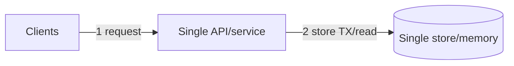
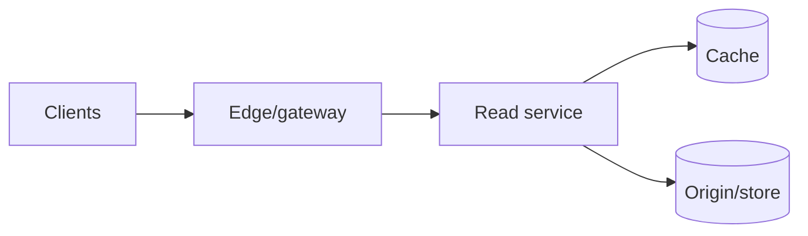
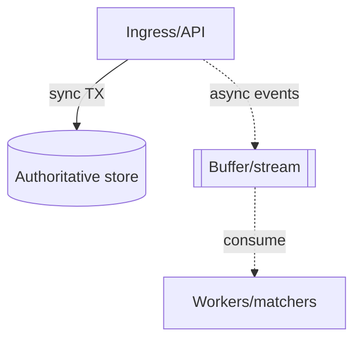
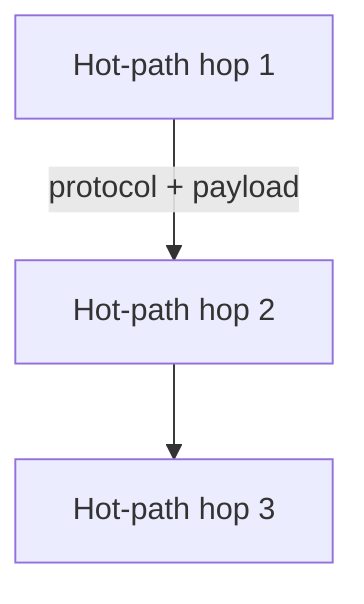
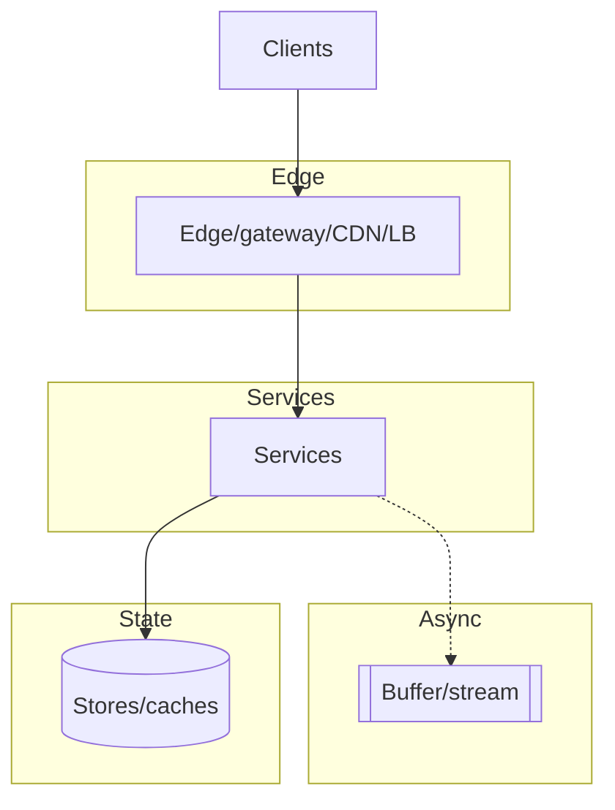

# Design: <system name> — full HLD + LLD (staged, agnostic)

> How to use this template (delete this note before emitting): copy this file per design. Keep all 12 sections. Fill `> Archetype:` first — it drives which BOTEC chains, diagrams, and deep-dive apply. Delete any conditional block that Step 2 does not force, with a one-line defer reason. Keep every mermaid block within its node cap; rationale lives in prose cards, never on arrows.

- Slice: `--full` (default, all sections) / `--hld-only` (Steps 0–7 minus LLD deep tables) / `--lld-only` (Steps 3, 6-deep, 8–10).
- Scope line: design <system> for <audience> at <scale>, strong <what> / eventual <what>.
- > Archetype: <single-node stateful | read-heavy serve | write-heavy ingest/streaming | live fan-out | transactional core | hybrid: …> — because <one-line classifier, e.g. "update rate × fan-out dominates, freshness SLO 1s">.

## Step 0 — Assumptions (FR / NFR / out-of-scope)

One-sentence restatement: <what the system does for whom>.

| Question | Assumption (prefix `Assumption:` if unconfirmed) | Why it drives the design |
|---|---|---|
| FR (2–4 core flows, verb-first) | 1. … 2. … 3. … | Names the journey the design lives or dies by |
| Scale horizon | DAU/MAU, devices/subs, growth, peak factor (state it) | Decides buffers, shards, caches |
| Read:write + payload | ratio, object bytes, retention | Splits read vs write optimization |
| Latency / availability | p99 per flow, nines per flow | Bans tiers from hot paths; sets degrade bar |
| Consistency / durability | strong <datasets> / eventual <datasets>; RPO | Splits TX core from best-effort paths |
| Out-of-scope (3–5) | … | Deferred with forcing condition to revisit |

## Step 1 — Naive v1 + mermaid #1 (≤3 nodes, archetype-shaped)

State archetype-shaped v1 (single-node struct for LRU; Clients → API → single store for services; producer → API → store for ingest).

- Why starting simple is correct (2–3 bullets tied to Step 0).
- Deliberately deferred: <component> until <forcing condition, e.g. "reads exceed ~10k QPS", "capacity exceeds RAM", "spike exceeds single-node buffer">.

## Step 2 — BOTEC break-table (only chains that can change a decision)

Show inputs → math → result with units on every row. Mandatory formulas: `QPS_avg = DAU × actions/day ÷ 86,400`; `QPS_peak = avg × peak_factor` (state factor); `storage/day = writes/day × bytes`; `total = storage/day × retention`; `bandwidth = QPS × payload` (read/write split); `servers ≈ peak ÷ per-server_QPS` (RDBMS ~1k, KV ~10k, cache ~100k–1M). Skip inapplicable chains with one-line why (e.g. LRU skips regions/bandwidth; stocks skips long retention).

| Load | Math (inputs + units) | Verdict (breaks what / forces what) |
|---|---|---|
| … | … | … |
| … | … | … |

Conclusion (2–3 lines): which verdicts force new tiers, and which confirm v1 holds.

## Step 3 — API / interface contracts (LLD surface)

Per core FR: method + path (or function signature for single-node, e.g. `get(k)`, `put(k,v)`, `evict()`), key request/response fields, pagination or streaming cursor, idempotency mechanism on non-idempotent writes, error contract (`429 + Retry-After`, `409` conflicts), versioning. One-line rationale per contract (retry safety, cacheability, ordering).

## Step 4 — Evolved reads HLD + mermaid #2 (≤10 nodes; include only if a Step-2 read verdict forces it, else defer in one line)

Per added component — **Why / Without-it / Change-when** (one line each, cite the verdict number): CDN/edge, cache strategy + TTL + eviction, search index, blob/object store.

## Step 5 — Evolved writes HLD + mermaid #3 (≤10 nodes; include only if a write/durability/coupling verdict forces it, else defer in one line)

Per added component — **Why / Without-it / Change-when**: shard/partition key + reason (locality vs spread), stream/queue choice + delivery guarantee + ordering scope (per-key, never global by default) + retention + DLQ, ID scheme, saga happy + compensation path for transactional cores.

## Step 6 — LLD deep-dive + mermaid #4 (≤10 nodes, one subsystem only)

Target (pick the archetype's pain): <eviction+concurrency | read path + herd guards | ingest buffer + backpressure | fan-out tier + deltas | TX boundary + saga>.

- Hot-path walk with per-hop protocol + payload bytes.
- Key/index/TTL/partition table (or struct + lock table for single-node: fields, invariants, lock granularity, expiry).
- Failure injection: kill each box → user-visible degrade + recovery (backoff + jitter + bulkhead + DLQ + replay). Money paths fail closed; everything else prefers stale/partial over errors.
- Bottleneck metric + signal threshold for the evolution section.

## Step 7 — Final topology + mermaid #5 (≤14 nodes, topology only)

No rationale on arrows. Full detail lives in Steps 4–6 and §8–§10.

## 8. Data model / structures

Stores (or in-memory structs): tables/keys, primary/shard/sort keys + rationale, indexes per hot query, TTLs/retention per cache/stream (or: struct fields, capacity math, eviction policy + why, concurrency design, persistence choice for single-node).

## 9. Key decisions & trade-offs

| Decision | Solves (cite FR/NFR/verdict) | Worsens (non-empty, blocking) | Change it when (breaking point) |
|---|---|---|---|
| … | … | … | … |

## 10. Failure modes & degradation

| Failure | User sees | Degrade path | Recovery (no stampede) |
|---|---|---|---|
| … | … | … | … |

## 11. Scale evolution (10× / 100×)

Current bottleneck + signal metrics/thresholds. What changes at 10× and 100× (shard/cell split, streaming join, edge push, read replicas, archive). What metric says it is time.

## 12. Open questions + validation

Open: <assumptions to confirm; deferred archetype-irrelevant blocks with one-line reasons>.

- [ ] Every §9 row has non-empty Worsens + breaking point.
- [ ] Every number carries inputs + units; skipped chains justified (YAGNI).
- [ ] Every component traces to an FR, NFR, or Step-2 verdict (else deleted).
- [ ] Every critical dependency has a degrade path (not just "retry"); money paths fail closed.
- [ ] Mermaid caps hold (10 / 10 / 10 / 10 / 14); arrows numbered sync solid, async dashed.
- [ ] Coverage sweep: media / IDs / search / logs / SLOs / jobs / counters addressed or explicitly deferred.
- [ ] No managed-service names/quotas unless user named a cloud (then "verify against current docs").
- [ ] Weakest dimension + current bottleneck + next-magnitude change stated; never claims perfection.
