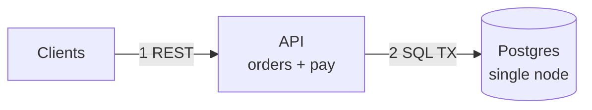

# Mermaid conventions (clean diagrams only)

Mermaid here is document illustration, not visual design. Small, numbered, honest.

## Allowed syntax

- Fences: ` ```mermaid` + `flowchart TB` or `flowchart LR` + closing fence. Nothing else (no `graph`, no `sequenceDiagram` for topology).
- Nodes: `ID[Short Label]`, stores `ID[(Short Label)]`, async bus `ID[[Short Label]]`, one `<br/>` max per label for a qualifier (`Order Svc<br/>saga + outbox`). No HTML, no click, no classDef floods.
- Edges: solid sync `A -->|1 VERB path| B` (numbered step + verb + path, ≤60 chars); async/cache/webhook/replay dashed `A -.->|label| B` only. Dotted rationale links (`-.-`) are banned — rationale lives in prose cards.
- Subgraphs: at most one level, at most 4 per diagram (`Edge`, `Services`, `Async`, `State`). No nested subgraphs.
- Style block: only on the final diagram, ≤5 `style` lines.

## Caps (blocking)

- Staged diagrams (v1, reads, writes, deep-dive): ≤10 nodes each.
- Final topology: ≤14 nodes.
- Arrow labels ≤60 chars, reasoning-free ("1 POST /orders", not "because…"). Rationale goes in Why/Without/Change cards under the diagram.

## Good vs bad

Good:



Bad (do not emit): 20 nodes, paragraph labels, rationale on arrows, nested subgraphs, `click`, HTML tags, unnumbered sync edges, solid arrows for async events.

## Pre-draw checklist

- [ ] Every node traces to an FR, NFR, or Step-2 verdict line (else delete it).
- [ ] Sync edges numbered in flow order; async edges dashed.
- [ ] Node count within cap; if over, split the stage.
- [ ] Labels short; Why/Without/Change written as prose cards below.
