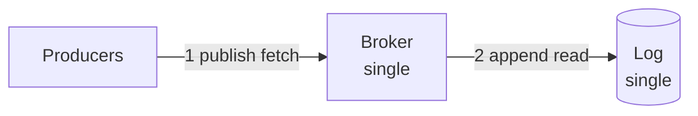
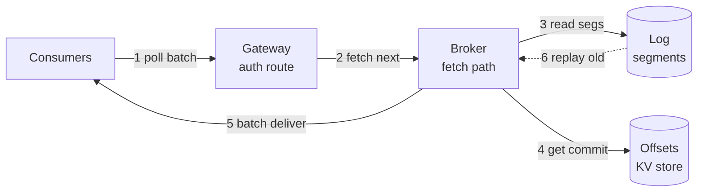
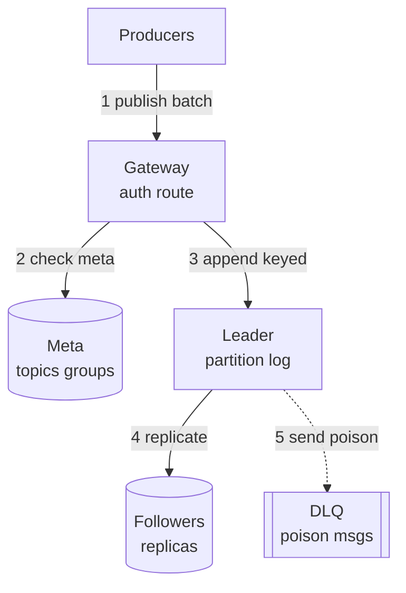
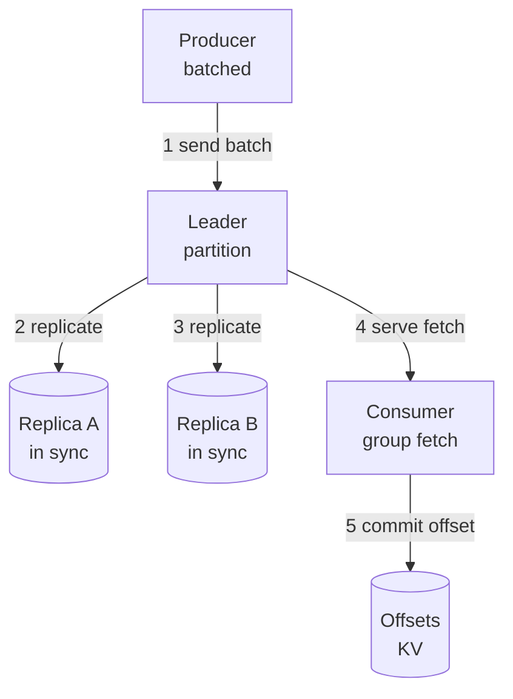
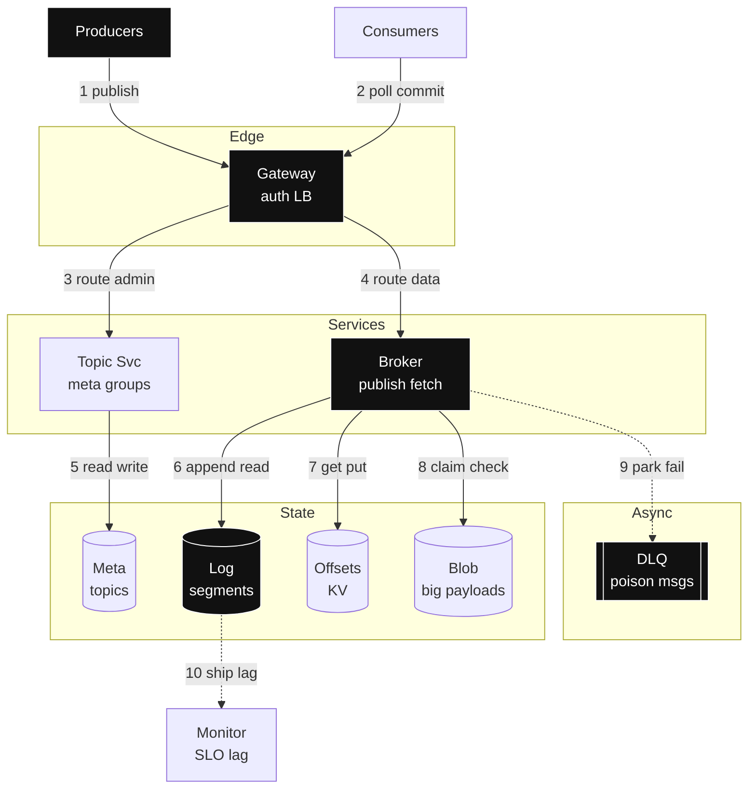

# Design: Distributed Topic-Based Message Queue — full HLD + LLD (staged, agnostic)

- Slice: `--full`
- Scope line: design a shared topic queue for app publishers and subscribers at 200M messages per day with 3x fan-out (one message delivered to 3 groups), strong durability (acked writes survive crashes) for acked (acknowledged: broker confirmed it stored) writes and per-key order (same key stays in order), not global order.
- > Archetype: write-heavy ingest / streaming — because sustained publish rate × payload bytes × retention plus fan-out deliveries dominate, then partition count plus replication plus consumer lag dominate.

## Step 0 — Assumptions (FR / NFR / out-of-scope)

One-sentence restatement: let any producer append small events to a named topic and let many subscriber groups each read every event at their own pace without loss. First principle: producers and consumers never meet. You append fast, read later. The log in the middle stores what happened.

| Question | Assumption (prefix `Assumption:` if unconfirmed) | Why it drives the design |
|---|---|---|
| FR (functional requirements: what the system does, verb-first) | 1. `Assumption:` create and delete topics with partition count and retention 2. publish messages to a topic with a key 3. subscribe with consumer groups and consume via pull with ack plus offset commit 4. replay by offset and park poison messages in DLQ | Names the journey the design lives or dies by; every box traces to publish or consume or replay |
| Scale horizon | `Assumption:` 2M producer DAU (daily active users: distinct publishers in a day), 5M consumer clients, 2,000 topics, growth 2x per year, peak factor 3.0 | Decides partitions, brokers, bandwidth |
| Read:write + payload | `Assumption:` 100 msgs per producer per day, avg payload 2,000B, fan-out 3 groups per message, retention 7 days | Splits publish write path from delivery read path; sizes storage |
| Latency / availability | `Assumption:` publish p99 (99th-percentile latency: near-worst case almost all beat) under 100ms, poll p99 under 200ms, 99.95% publish availability | Bans heavy work from publish path; sets degrade bar to shed not block |
| Consistency / durability | Per-key ordering inside a partition, no global ordering; at-least-once (retry until acked: may arrive twice) delivery plus idempotent consumers; RPO (recovery-point objective: how much acked data you may lose) zero for acked writes | Splits durable log core from best-effort tail features; forces replication plus acks plus DLQ (dead-letter queue: parking lot for poison messages that keep failing) |
| Out-of-scope (3–5) | 1. End-to-end exactly-once processing 2. Global ordering across partitions 3. Payload search and analytics 4. Multi-region active-active writes 5. Device edge protocol | Deferred with forcing condition: add exactly-once sink TX when a money flow forces it; add search when payload query rate forces it |

Scope method follows `requirements-scoping` (scope recipe: FR plus NFR plus out-of-scope lists with revisable assumptions) — three short lists, no silent facts. You write the guesses down so later numbers can argue with them.

## Step 1 — Naive v1 + mermaid #1 (≤3 nodes, archetype-shaped)

Archetype: write-heavy ingest plus streaming → v1 = producers → single broker → single log, no groups mesh. Why start tiny? One writer means no ordering fights, no replica lag. You learn buffer, durability, replay before you pay for partitions.

- Why starting simple is correct: (a) single broker satisfies publish plus poll plus replay with zero coordination; (b) append plus offset commit are local calls, no leader election or ISR (in-sync replicas: followers fully caught up) gap; (c) single-node publish rate and 400GB per day are the BOTEC (back-of-the-envelope calculation: rough sizing math that decides shape) baseline before sharding.
- Deliberately deferred: partitions until one log exceeds disk or throughput; consumer groups until one consumer cannot keep up; DLQ until poison rate is measured; separate metadata store until topic count forces it. Same rule as always: do not build what no number asks for yet.

## Step 2 — BOTEC break-table (only chains that can change a decision)

Formulas: `QPS_avg = DAU × actions per day ÷ 86,400`; `QPS_peak = avg × peak_factor`; `storage per day = writes per day × bytes`; `total = storage per day × retention`; `bandwidth = QPS × payload`; `servers ≈ peak ÷ per-server_QPS`. Exact check pattern via `back-of-the-envelope` (sizing math: QPS plus storage plus bandwidth plus servers) calculator. Every row shows inputs → math → units.

| Load | Math (inputs + units) | Verdict (breaks what / forces what) |
|---|---|---|
| Publish avg QPS (queries per second: requests arriving each second) | 2,000,000 producers × 100 msgs per day = 200,000,000 msgs per day ÷ 86,400 s per day = **2,315 msgs per s avg** | Single broker survives avg but has no headroom |
| Publish peak QPS | 2,315 msgs per s × 3.0 peak_factor = **6,944 msgs per s peak** | Breaks single ingress; forces replicated partition log plus L7 (layer-7: HTTP-aware routing) gateway pool |
| Delivery peak | 6,944 msgs per s × 3.0 fan-out groups = **20,833 deliveries per s peak** | Breaks DB polling; forces pull fetch from sequential log plus offset KV (key-value: get and put by key) store, never per-message SQL reads |
| Storage per day | 200,000,000 msgs per day × 2,000B = 400,000,000,000B per day = **400GB per day logical** | Breaks single disk within days; forces segmented retained log |
| Storage total | 400GB per day × 7 days retention = **2.8TB logical** × 3 replicas = **8.4TB physical** | Forces 9-broker cluster across 3 AZs (availability zones: isolated data halls), never single RDBMS (relational database) blobs |
| Bandwidth publish peak | 6,944 msgs per s × 2,000B = 13,888,000B per s ≈ **13.9MB per s ingress** | Fits NICs (network cards); no dedicated ingest cells yet |
| Bandwidth delivery peak | 20,833 deliveries per s × 2,000B = 41,666,000B per s ≈ **41.7MB per s egress** | Forces sequential segment reads plus fetch batching; total ≈55.6MB per s |
| Partitions needed | `Assumption:` 2,000 topics × 6 partitions avg = **12,000 partitions** × 3 replicas = **36,000 replicas** ÷ 9 brokers = **4,000 replicas per broker** | Count forces broker number, not throughput; 12k primaries is the planning ceiling |
| Broker servers | 27,777 total ops per s peak ÷ 10,000 QPS per KV node = **2.8 → 3 min** → choose **9 for AZ quorum plus partition headroom** | QPS says 3, partition plus failure domain says 9 |
| Offset commits | 20,833 deliveries per s ÷ 50 msgs per commit batch = **417 commits per s peak** | Fits single KV shard; no sharded counter yet |

Conclusion: 6,944 publish plus 20,833 delivery peak with 400GB per day and 8.4TB physical force a partitioned replicated log with 9 brokers and a separate offset store; throughput alone would fit 3 nodes, partition count plus AZ (availability zone) survival pushes to 9. Single-node v1 holds until writes exceed ~1k per s or retained bytes exceed one disk. Skipped: per-row money TX (transaction) analysis — no money path; CDN (content delivery network: edge copies near users) offload — 2KB payloads are origin fetches; cross-region sync — single-region writes assumed per out-of-scope.

## Step 3 — API / interface contracts (LLD surface)

Per `api-design` (contract recipe: REST plus cursor plus idempotency plus errors with versioning) — REST plus JSON (JavaScript object notation: text record shape) default, verbs by retry safety, cursor (opaque bookmark into an offset, never a row number) polling, stable error envelope, `/v1`. First principle for you: publishes will be retried, so every write must survive being sent twice.

- `POST /v1/topics` `{"name":"orders","partitions":12,"retention_s":604800}` → 201 `{topic, partitions}` — admin write, `Idempotency-Key` (client-sent dedupe token: same key plus same body returns stored answer) required. Serves FR-1. Rationale: safe topic resubmits.
- `POST /v1/topics/{name}/publish` `{"key":"user-42","payload_b64":"...","idempotency_key":"...","partition_hint":null}` → 202 `{message_id, partition, offset}` — unsafe write, server dedupes on `idempotency_key` 24h TTL (time to live: auto-expire timer). Serves FR-2. Rationale: at-least-once publish without double append.
- `POST /v1/groups/{group}/subscribe` `{"topics":["orders"]}` → 200 `{assigned_partitions:[...]}` — control call, idempotent PUT (repeatable write: twice changes nothing) semantics. Serves FR-3. Rationale: sticky assignment revision for rebalance.
- `GET /v1/groups/{group}/poll?cursor=eyJwIjozLCJvIjoxMDB9&limit=50&max_wait_ms=500` → 200 `{messages:[{message_id, key, payload_b64, partition, offset}], next_cursor, has_more}` — cursor over partition plus offset, never offset pagination. Serves FR-3. Rationale: O (constant-time) page at any depth, long-poll (held request: server waits briefly for new data) without hot spinning.
- `POST /v1/groups/{group}/commit` `{"partition":3,"offset":152}` → 200 `{committed:true}` — idempotent per offset; replay converges. Serves FR-3. Rationale: consumer-tracked position enables replay.
- `POST /v1/groups/{group}/seek` `{"partition":3,"offset":100}` → 200 `{cursor}` — replay primitive. Serves FR-4. Rationale: time travel bounded by retention.
- Errors: `{error:{code,message,request_id,retryable}}` plus `429 + Retry-After` (wait this long before retrying) on publish shed, `409` offset conflict, `503` no leader. Versioning: `/v1` URI (address path) plus additive fields.
- Envelope on the wire per `messaging-streaming` (async transport recipe: queue versus stream plus guarantees plus DLQ plus backpressure): `{message_id, type, schema_version, partition_key, timestamp, trace_id}` plus payload. Ack contract: ack after process gives at-least-once; ack before gives at-most-once (fire and forget: may drop) — you want after-process here.

## Step 4 — Evolved reads HLD + mermaid #2 (≤10 nodes; Step-2 delivery verdict forces it)

Verdict forcing reads: 20,833 deliveries per s peak cannot be per-message DB reads. First principle: readers pull big sequential batches from an append-only log and remember their own bookmark. The broker never tracks per-consumer queues.

Per added component — **Why / Without-it / Change-when** (cites verdict):

- Gateway pool with L7 routing plus auth — Why: terminates publish plus poll at 27.8k peak and routes by topic per `load-balancing` (traffic spreading: L4 raw versus L7 content-aware with health gating). Without-it: brokers absorb TLS (transport encryption) plus auth plus imbalance. Change-when: gateway p99 exceeds 20ms or TLS CPU saturates → add L4 (transport-layer: IP plus port only) front plus scale stateless tier.
- Fetch path with batching plus long-poll — Why: 20,833 deliveries per s at 2KB needs ~41.7MB per s sequential reads, not random rows. Without-it: every poll hits metadata plus offset store and melts. Change-when: fetch p99 over 200ms sustained → add read cache for hot partitions per `caching` (hot-read recipe: TTL plus eviction plus herd guards).
- Segment log store, partitioned — Why: 400GB per day with 7-day replay needs immutable (write-once, never edited) segments keyed by topic plus partition plus offset per `data-storage` (store recipe: keys plus sharding plus replication). Without-it: 8.4TB on one disk stalls. Change-when: per-broker replicas over 4k sustained → add brokers or cut cold-topic partitions.
- Offset KV store — Why: 417 commits per s peak with read-your-writes (see your own writes: session sees its change) per group. Without-it: broker holds consumer state and loses statelessness. Change-when: commit rate over 5k per s → shard by group hash.

## Step 5 — Evolved writes HLD + mermaid #3 (≤10 nodes; publish plus durability verdict forces it)

Verdict forcing writes: 6,944 publish peak with RPO zero forces replicated append, not single write. First principle: accept fast, copy three ways, ack only when copies agree. Slow enough to be safe, fast enough to hit 100ms p99.

Per added component — **Why / Without-it / Change-when**:

- Topic metadata in Postgres (relational store) — Why: 2k topics plus group assignments need joins plus transactions per `service-decomposition` (service split recipe: boundaries plus gateway plus sync versus async per seam). Without-it: brokers mix control state with data path. Change-when: metadata QPS over ~1k sustained → cache plus read replicas.
- Partition leader with key hashing — Why: per-key (per-user or per-order) ordering without global lock; key picks partition so order holds where you need it. Without-it: random spread breaks your ordering promise. Change-when: one key exceeds partition throughput → sub-key plus split hot partition.
- Replicated followers with quorum ack — Why: RPO zero needs majority ack before success per `consistency-coordination` (agreement recipe: CAP plus quorum plus saga, AP accepts and reconciles, CP rejects on split). Without-it: one disk loss loses acked messages. Change-when: cross-region durability forced → async replica plus explicit lag SLO (service-level objective).
- DLQ plus retry cap — Why: poison messages would otherwise redeliver forever and burn 20k delivery budget. Without-it: one bad payload stalls a partition. Change-when: DLQ rate over 1% sustained → fix producer schema plus add schema registry (versioned payload gate).
- Message IDs via `sequencer` (ID minting recipe: UUID versus time-sortable versus Snowflake with clock-skew guards) — ULID (time-sortable unique id: random but sorts by creation time) library-side for `message_id` plus per-partition sequence for offset; no central allocator. Without-it: central ticket caps 6.9k publish. Change-when: 64-bit sortable integer required → Snowflake-style layout.

## Step 6 — LLD deep-dive + mermaid #4 (≤10 nodes, one subsystem only)

Target: ingest buffer plus replication — the partition commit path, because RPO zero plus 100ms p99 live or die here.

- Hot-path walk with per-hop protocol plus payload bytes. You send `POST` batched JSON ~10×2KB = 20KB per request to gateway; gateway gRPC (binary RPC: fast typed internal calls) forwards 20KB to leader; leader writes sequential segment plus replicates 20KB to 2 followers; quorum ack (2 of 3 incl leader) returns `{partition, base_offset}`; consumer long-polls and gets 50×2KB = 100KB batch; consumer commits 16B offset key. Total publish p99 budget: gateway 10ms plus append 20ms plus replicate 30ms plus ack 5ms = ~65ms under SLO.
- Key plus index plus TTL plus partition table (or struct plus lock table for single-node).

| Key | Store | Shape plus rationale |
|---|---|---|
| Segment `topic + partition + base_offset` → bytes | Log segments | Append-only files ~512MB each, index `offset → file pos` in memory; partition key = hash of message key for locality; retention TTL 7 days then delete |
| Offset `group + topic + partition` → `offset + gen` | Offset KV | Read-your-writes per group; 417 commits per s peak fits one shard; TTL none, compacted (keep latest per key only) |
| Meta `topic → {partitions, retention, schema_v}` | Postgres | Source of truth for 2k topics; index on `name`; cached 30s at gateway |
| Dedup `idempotency_key → {partition, offset}` | KV with 24h TTL | Makes at-least-once publish safe; 6.9k writes per s peak, 24h window ≈600M keys max before expiry needs ~1.2TB with values — shard by key hash |
| DLQ `topic-dlq + partition → failed envelope` | Log plus index | Keeps original envelope plus reason plus attempt count; 7-day retention, manual replay |

- Failure injection: kill each box → user-visible degrade plus recovery (backoff plus jitter plus bulkhead plus DLQ plus replay per `resilience-failure` (containment recipe: timeout plus breaker plus bulkhead plus degrade plus shed)). Money paths fail closed (reject rather than risk loss); everything else prefers stale or partial. Leader loss → publishes to its partitions get `503` for seconds, consumers read from followers; standby promotes via election (voted single boss) with fencing (old boss blocked); half-open probe (few test requests) trickle avoids herd. Follower lag → removed from ISR, publish still quorum with 2 of 3; alert on `isr_shrink_rate`. Gateway loss → LB (load balancer) health gate pulls it, no user impact; slow-start (gradual re-admit) ramp on return. Offset store slow → commits queue client-side, consumers may reprocess; idempotent handlers converge. Poison flood → cap 5 retries with jitter then DLQ; shed low-priority publishes with `429`.
- Bottleneck metric plus signal threshold for the evolution section. Watch `produce_p99_ms >80` for 10 min, `isr_lag_msgs >5k`, `consumer_lag_s >60`, `replicas_per_broker >4k`. Any one sustained means add brokers or cut partitions.

## Step 7 — Final topology + mermaid #5 (≤14 nodes, topology only)

No rationale on arrows. Full detail lives in Steps 4–6 and §8–§10.

## 8. Data model / structures

Three things to store: the immutable log bytes, who read up to where, which topics exist. Everything else is a cache or an index on those three.

- Log segments: key `topic_hash + topic + partition + base_offset` → `{messages:[{offset, key, message_id, ts, payload_ptr}], CRC (checksum: corruption detector)}`. Partition by hash of message key for per-key order; 512MB segments, in-memory sparse index. 2.8TB logical, 8.4TB with RF (replication factor: copy count) 3.
- Offsets: key `group + topic + partition` → `{offset, gen, updated_at}`. Partition by group hash; compaction keeps latest only. 417 commits per s peak at 20,833 deliveries.
- Metadata: tables `topics(name PK (primary key: unique lookup id), partitions, retention_s, schema_v)`, `groups(name PK, topics[])`, `assignments(group, partition, member, gen)`. Postgres single primary handles admin QPS; gateway caches 30s.
- Dedup: key `idempotency_key` → `{partition, offset, resp_hash}` 24h TTL; shard by key hash for 6.9k publish peak.
- Large payloads: messages over 256KB stored via claim-check (pointer not bytes: keep big bytes aside, pass a ticket) in `blob-store` (big-file storage: flat key-to-bytes with replication) object `{blob_id → bytes}` with signed URL (time-boxed secret link); log holds `{blob_id, size}` only. Keeps p99 intact for 2KB median (middle value).
- IDs per `sequencer`: library ULID for global `message_id` time-sort plus per-partition monotonic offset for order; no central mint, no clock trust beyond ms sort.

## 9. Key decisions & trade-offs

Each row below is a trade: what you gain, what you pay, when you change it.

| Decision | Solves (cite FR/NFR/verdict) | Worsens (non-empty, blocking) | Change it when (breaking point) |
|---|---|---|---|
| Partitioned retained log, not work queue | 20,833 deliveries per s with independent replay per group, 2.8TB retained (FR-3/FR-4, V-delivery) | Operational weight: partitions, offsets, rebalances versus simple queue | Single worker pool with no replay need → plain work queue |
| At-least-once plus idempotent consumers | RPO zero without end-to-end exactly-once cost (FR-2/FR-3) | Duplicates on every retry; every consumer must dedupe | Loss acceptable for a class → at-most-once fast lane |
| Per-key ordering only, never global | Preserves user and order causality without global lock (FR-2) | Consumers must handle cross-key interleave; global scans unsorted | True global sequence forced → single partition plus throughput cap accepted |
| Quorum ack 2 of 3 | RPO zero on single disk loss under 100ms p99 (NFR durability) | Write latency plus unavailable on minority split per CAP (consistency-availability-partition theorem) | Latency budget under 20ms → leader-only ack plus async replicas |
| Pull long-poll, not push | Backpressure (pushback that sheds instead of buffering) free; 5M consumers do not hold broker connections (V-delivery) | Poll delay plus empty polls; freshness bounded by poll interval | Sub-100ms push freshness forced → WS (websocket: persistent push socket) plus SSE (server-sent events: one-way push) fan-out tier |
| Offset commits in KV, not in log | 417 commits per s with read-your-writes isolation from data path (FR-3) | Second store to operate; commit lag can cause reprocessing | Commit rate trivial → store offsets in log compacted topic |
| DLQ with cap 5 plus jitter | Poison contained, partition keeps moving (FR-4) | DLQ triage (a human looking) burden; silent drop if ignored | Poison rate near zero → drop DLQ for a class |
| 9 brokers over 3 AZs, not 3 | 12k partitions plus 36k replicas plus AZ survival (V-partitions) | 3x cost plus rebalance churn on membership change | Partition count under 2k and AZ loss tolerable → 3 brokers |
| Claim-check over 256KB to blob | Keeps 2KB median p99 while allowing large events (NFR latency) | Extra hop on large reads; blob lifecycle to manage | Large share over 10% → dedicated media path |
| Gateway plus Topic Svc split per `service-decomposition` | Independent deploy of control versus data; coarse granularity | Extra hop plus gateway SPOF (single point of failure) risk | Gateway p99 over budget → collapse or split data plane further |

## 10. Failure modes & degradation

Mindset: everything below will happen. The question is whether users notice. Per `resilience-failure` plus `load-balancing` health gating (only send to boxes passing checks).

| Failure | User sees | Degrade path | Recovery (no stampede) |
|---|---|---|---|
| Broker leader crash | Publish `503` on its partitions for seconds | Retry same key to new leader after election; serve reads from ISR followers | Fencing plus election, half-open trickle, jittered reconnect, slow-start ramp |
| AZ loss | Higher p99, fewer replicas | Quorum still 2 of 3 across surviving AZs; shed low-priority publishes `429` | Re-replicate missing copies async, cap prefill bandwidth |
| Follower lag beyond ISR | None initially | Shrink ISR, continue quorum; alert | Catch up from leader segments, rejoin ISR when lag under 1k msgs |
| Poison message loop | None to user | Cap 5 retries with backoff plus jitter then DLQ with reason plus count | Inspect plus replay DLQ, blocklist schema version |
| Offset store slow | Reprocessing after restart | Buffer commits client-side, continue fetch; mark `stale:true` | Breaker on commits, drain on store return |
| Gateway overload | Publish `429` | Shed low-priority plus `Retry-After`; bulkhead (separate pools per dependency) publish versus poll | Autoscale stateless tier, per-tenant rate caps |
| Hot partition on one key | That key slow, others fine | Sub-partition hot key, batch plus compress; per-key throttle | Split partition, rehash sub-key |
| Disk full on broker | Writes rejected on its partitions | Stop leadership, read-only serve, expire oldest per retention | Add disk plus rebalance, alert at 70% full |

Timeouts fit budget: gateway 10ms queue plus leader append 20ms plus replicate 30ms, poll hold 500ms max, commit 50ms. Retries max 5 with jitter then DLQ; breaker opens at 50% 5xx (server-error responses) over 60s.

## 11. Scale evolution (10× / 100×)

What breaks first when traffic grows? You already named it. Current bottleneck plus signals per `scaling-evolution` (walk-the-ladder: add only the next tier the numbers force): partition replica count per broker before raw QPS (queries per second); signals `replicas_per_broker >4k`, `produce_p99_ms >80`, `consumer_lag_s >60`, `isr_shrink_rate` rising.

- 10× (≈69k publish peak per s, 4TB per day, 28TB logical): add brokers to ~30, split hot topics to 48 partitions, separate publish versus fetch fleets, add fetch cache for hot partitions, shard offsets by group, add per-tenant publish quotas. Signal: `per_partition_QPS` over worker ceiling or `bandwidth` over NIC headroom for 10 min.
- 100× (≈694k publish peak per s, 40TB per day): cell split by business domain plus hash ring (consistent hashing: ring placement where only K over N keys move on membership change) per `consistency-coordination`, multi-region async replicas with lag SLO, tier segments hot plus cool plus archive per `blob-store`, durable scheduler for backfill. Signal: single-cell gossip over 5s or cross-region RTT (round-trip time) dominates p99.
- What metric says it is time: `consumer_lag_s`, `produce_p99_ms`, `replicas_per_broker`, `egress_cost_per_TB`. This design holds until ~70k publish peak per cell or ~30TB logical per log cluster; beyond that add cells, not bigger nodes.

## 12. Open questions + validation

Open: confirm 2M producer DAU plus 100 msgs per day (200M assumed), 2KB p50 (median) versus p99 size, 2k topic count plus hot split, 3x fan-out groups, 7-day retention versus compliance, large-payload share over 256KB, per-key ordering scope. Deferred with one-line reasons: `distributed-search` (ranked text search: payload lookup by id only, no full-text index until query rate forces it), `content-delivery` (edge CDN: origin polls, not edge static), `caching` full tier (hot-read cache: fetch batches suffice until hit ratio forces it), `dns` geo-steer (domain routing: single-region LB suffices until multi-region).

- [ ] Every §9 row has non-empty Worsens + breaking point.
- [ ] Every number carries inputs + units; skipped chains justified (YAGNI).
- [ ] Every component traces to an FR, NFR, or Step-2 verdict (else deleted).
- [ ] Every critical dependency has a degrade path (not just "retry"); money paths fail closed.
- [ ] Mermaid caps hold (10 / 10 / 10 / 10 / 14); arrows numbered sync solid, async dashed.
- [ ] Coverage sweep: media / IDs / search / logs / SLOs / jobs / counters addressed or explicitly deferred.
- [ ] No managed-service names/quotas unless user named a cloud (then "verify against current docs").
- [ ] Weakest dimension + current bottleneck + next-magnitude change stated; never claims perfection.

Coverage details (watch lag first): media — payloads over 256KB claim-check to `blob-store`, small inline; IDs — `sequencer` library ULID plus per-partition offset, no central mint; search — deferred, id lookup only; logs — `distributed-logging` (log pipeline: collect plus buffer plus ship plus index plus retain) structured JSON with `trace_id` (request passport stamped across services) plus `message_id` correlation, async ship, 7d hot plus cold archive; SLOs — `observability` (measurement recipe: RED plus USE plus SLO burn): 99.95% publish success, publish p99 under 100ms, poll p99 under 200ms, `consumer_lag_s` under 60, RED (rate errors duration: request lens) on gateway plus broker, USE (utilization saturation errors: resource lens) on log plus offsets; SLI (measured signal) is lag plus p99 plus burn rate; jobs — `task-scheduling` (timed-work recipe: cron plus leasing plus priorities) retention sweeper plus DLQ replayer plus rebalancer with jittered ticks and leased workers; counters — `sharded-counters` (hot-count recipe: striped tallies plus cached aggregate) for per-topic publish rates with cached sum, offsets stay exact. Weakest dimension: partition count per broker plus hot-key skew; current bottleneck replica count; next change: 30 brokers plus hot-topic splits at 10×.
