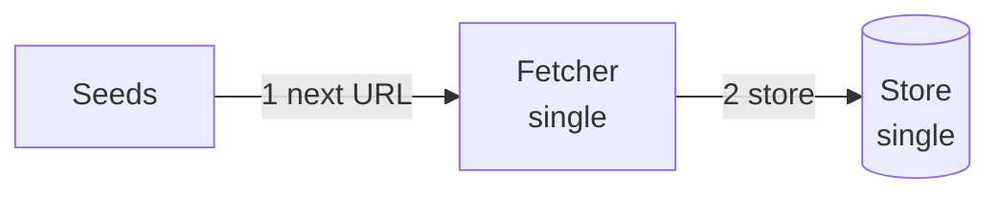
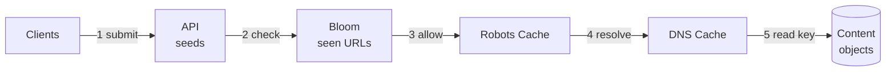
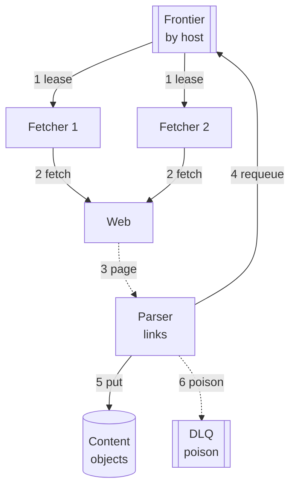
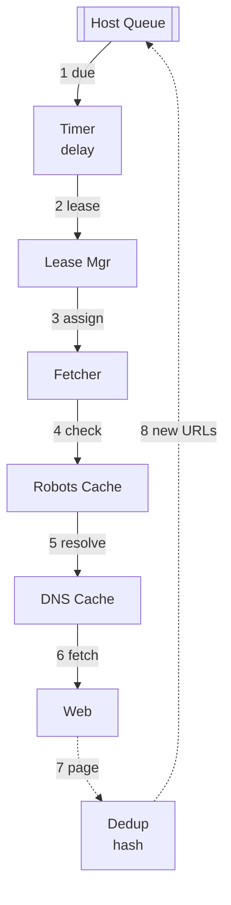
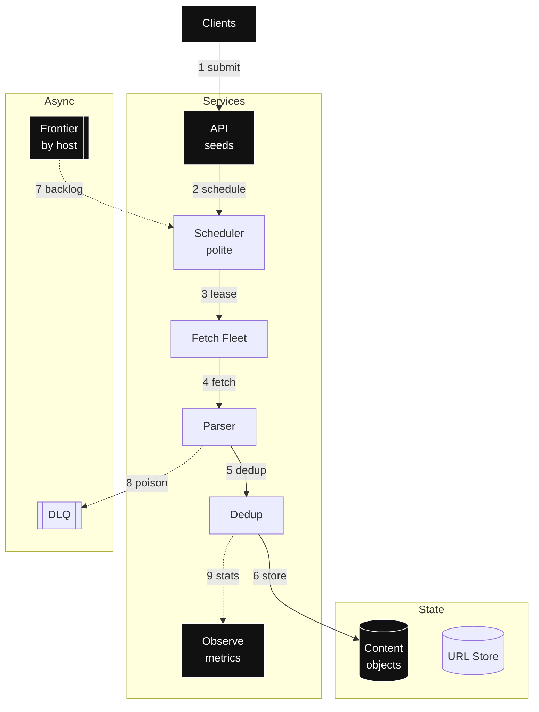

# Design: Web Crawler — full HLD + LLD (staged, agnostic)

- Slice: `--full`
- Scope line: you are building a polite (waits its turn per site: caps requests per second to any one host) large-scale web crawler for a search index at 500M pages per day. Stored pages lag the live web by days. That is eventual freshness (agreeing soon, not instantly), by design.
- > Archetype: write-heavy ingest / streaming (most work is absorbing a firehose of fetches, not answering queries) — because sustained fetch rate × page bytes × per-host politeness dominates, then frontier partitioning (splitting the giant to-visit list by host) + dedup (duplicate removal) dominates.

## Step 0 — Assumptions (FR / NFR / out-of-scope)

One-sentence restatement: continuously discover, fetch, parse and store web pages politely so an index pipeline always has fresh content. First principle: the web is large and remote hosts are slow. So you win with many polite fetchers in parallel, none waiting on another.

| Question | Assumption (prefix `Assumption:` if unconfirmed) | Why it drives the design |
|---|---|---|
| FR (2–4 core flows, verb-first) | 1. `Assumption:` submit seed URLs (starting points) 2. `Assumption:` fetch pages politely per host 3. `Assumption:` parse links and enqueue discovered URLs 4. `Assumption:` store content deduplicated | Names the journey the design lives or dies by; every box traces to fetch/parse/store |
| Scale horizon | `Assumption:` 500M pages/day ingest, ~100M hosts, growth 2×/yr, peak factor 2.0 | Decides fetch fleet, frontier partitions, bandwidth |
| Read:write + payload | `Assumption:` ingest-dominated ~12k fetches per sec peak; avg fetched page ~50KB, ~40 percent new after dedup; frontier reads are leases (borrowed jobs that return if unfinished) not queries | Splits fetch/parse/store write path from rare content reads |
| Latency / availability | `Assumption:` per-fetch p99 (99th-percentile latency: the near-worst case almost every fetch beats) <10s incl politeness wait; freshness days not seconds; 99.9% (uptime share) scheduler availability, fetch best-effort | Bans sync indexing/ranking from crawl path; sets degrade bar to shed |
| Consistency / durability | Eventual dedup via content hash (fingerprint of the bytes: same bytes, same hash); frontier recoverable not durable per URL; content RPO (recovery-point objective: how much recent data you may lose) ~0 once stored | Splits durable content store from replayable frontier queue |
| Out-of-scope (3–5) | 1. Ranking / query serving 2. Full-browser JS render farm 3. Ad / spam / abuse classification 4. Multi-region active serving 5. Per-publisher analytics | Deferred with forcing condition: add render pool when JS-only share forces it; add ranking when index serving appears |

Scope method follows `requirements-scoping`: three lists — FR (functional requirements: what the system does), NFR (non-functional requirements: how fast, how fresh, at what scale) — plus revisable `Assumption:` lines, no silent facts. You write guesses down so you can argue with them later.

## Step 1 — Naive v1 + mermaid #1 (≤3 nodes, archetype-shaped)

Archetype: write-heavy ingest → v1 = seeds → single fetcher → single store, no queue mesh. First principle: one fetcher cannot double-visit a page or overload a site. There is nobody to disagree with. So start there. Add parallelism only when page count or bytes force you.

- Why starting simple is correct: (a) one fetcher satisfies FR with zero coordination and trivial politeness via sleep; (b) fetch plus parse plus store are local calls, no lease/partition risk; (c) single-node fetch rate and bytes are the BOTEC (back-of-the-envelope calculation: rough sizing math that decides the shape) baseline before partitioning.
- Deliberately deferred: frontier queue (durable to-visit list with ordering) until fetch rate exceeds one NIC (network card) or politeness needs per-host state; dedup Bloom (Bloom filter: tiny probably-seen set that never misses a true seen but sometimes false-alarms) until refetch waste is measured; robots (the site's crawling rulebook file) /DNS (domain-name lookup: hostname to address) cache until lookup QPS (queries per second) forces it; render pool until JS-only share forces it. Same rule as always: don't build what no number is asking for yet.

## Step 2 — BOTEC break-table (only chains that can change a decision)

Formulas: `QPS_avg = pages_per_day ÷ 86,400`; `QPS_peak = avg × peak_factor (how many times busier the busiest second is than average)`; `stored_per_day = pages_per_day × new_frac × bytes`; `total = stored_per_day × retention`; `bandwidth = QPS × payload`; `servers ≈ peak ÷ per-server_QPS`. Exact check via `skills/back-of-the-envelope/scripts/botec.py` with `--dau 500e6 --actions 1 --peak 2 --obj-bytes 50e3 --media-frac 0.4 --retention-days 90` → avg 5.8K, peak 11.6K, 10TB per day, 900TB total, 579MB per s. Every row shows inputs → math → units, no exceptions.

| Load | Math (inputs + units) | Verdict (breaks what / forces what) |
|---|---|---|
| Fetch avg | 500M pages/day ÷ 86,400 s/day = **5,787 fetches per s avg** | Single fetcher dead by ~100× |
| Fetch peak | 5,787 per s × 2.0 peak_factor = **11,574 fetches per s peak ≈ 11.6K** | Forces partitioned frontier + 100s of fetch workers |
| Crawl bandwidth | 11,574 per s × 50,000B = 5.79e8 B/s ≈ **579MB per s peak egress** | Forces distributed fetch NICs + per-host rate caps; fits multi-host fleet |
| Stored per day | 500M × 0.40 new_frac × 50,000B = 1.0e13 B/day = **10TB per day** | Breaks single DB; forces object store + dedup before store |
| Stored total | 10TB/day × 90 days retention = **900TB total** | Forces erasure-coded object store + lifecycle, never RDBMS blobs |
| Frontier size | `Assumption:` 8B known URLs × ~200B per entry = 1.6e12 B ≈ **1.6TB frontier index** | Forces partitioned URL store, not single queue |
| Dedup memory | `Assumption:` 8B URLs × ~10 bits per entry Bloom ≈ 1.0e10 B ≈ **10GB per replica** | Fits RAM sharded Bloom; forces sharded seen-set |
| Politeness cap | `Assumption:` 1 req per 2s per host avg → one host ≤ 0.5 per s; 11.6K per s ÷ 0.5 = **23K active hosts minimum** | With 100M hosts this holds; forces per-host queues not global FIFO (first in, first out: one shared line) |

Conclusion: 11.6K peak fetches per s plus 10TB per day new plus 900TB total force a host-partitioned frontier with a large fetch fleet feeding an object content store; dedup at 40 percent new halves the store. Single-node v1 holds until pages per day exceed ~100K or bytes exceed one disk. Skipped: per-row TX (transaction) analysis, cross-region sync, query fan-out (one request splitting into many) — YAGNI (you aren't gonna need it: do not build what no number forces) for a crawler with no serving path and no named cloud.

## Step 3 — API / interface contracts (LLD surface)

Per `api-design`: REST/JSON default, verbs by retry safety, cursor (opaque bookmark into a sorted order, never a row offset) pagination, stable error envelope, `/v1`. First principle: crawlers live on retries. Networks fail, hosts hang. So every write below is safe to repeat.

- `POST /v1/seeds` `{"urls":["https://ex.com/a"],"source":"ops"}` → 202 `{accepted:120, batch_id}` — unsafe write, client sends `Idempotency-Key` (client-sent dedupe token: same token plus same body returns the stored answer instead of re-executing) per batch; replay returns stored accept counts. Serves FR-1. Rationale: dedupes seed resubmits.
- `GET /v1/frontier/lease?worker=w12&limit=50` → 200 `{leases:[{url, lease_id, visible_after}], next_cursor}` — cursor over host shards, never offset. Serves fetch scheduling. Rationale: pull leasing (workers asking for work beats a boss assigning it) gives backpressure (pushback that sheds load instead of buffering forever) for free.
- `PUT /v1/fetch/result` `{lease_id, status:200, content_hash, bytes_b64, links:[...]}` → 200 `{durable:true}` — `PUT` idempotent (safe to repeat: twice changes nothing) per `lease_id`; replay converges. Serves FR-2/FR-3. Rationale: at-least-once delivery (retry until acknowledged: may arrive twice) plus idempotent consumer.
- `GET /v1/content/{dochash}` → 200 bytes / 404 — retry-safe idempotent read for index pipeline. Serves FR-4.
- Errors: `{error:{code,message,request_id,retryable}}` + `429` (too many requests: back off) `+ Retry-After` (wait this long) on politeness shed, `409` lease conflict, `503` frontier overload. Versioning: `/v1` URI plus additive fields.
- URL contract: canonicalized (rewritten into one standard shape so duplicates match) `scheme://host/path` with lowercased host, stripped tracking params, max 2KB; doc ID = content hash plus ULID (time-sortable unique id: random but sorts by creation time) time prefix per `sequencer` (hash for dedup, ULID for time sort).

## Step 4 — Evolved reads HLD + mermaid #2 (≤10 nodes; Step-2 read verdict forces it)

Verdicts forcing reads: robots plus DNS lookups at 11.6K per s, seen-URL checks over 8B entries, content reads by pipeline. First principle: never pay for the same answer twice. Check memory first, network last.

Per added component — Why / Without-it / Change-when (cites verdict):

- Seen-URL Bloom sharded 10GB per replica — Why: 8B-URL frontier checks at 11.6K per s without a store read per URL. Without-it: every fetch hits the 1.6TB URL store. Change-when: false-positive refetch >1 percent sustained → grow bits or add exact secondary check. Applies `caching` seen-cache recipe: negative plus Bloom fronting for penetration-style (requests for unknown keys that sail past the cache) unknown URLs.
- Robots plus DNS cache with TTL (time to live: auto-expire timer) — Why: per-host robots and DNS at fetch QPS would triple egress and break politeness. Without-it: 3× origin load plus resolver bans. Change-when: hit ratio (share answered from cache) <90 percent → widen TTL plus jitter (randomized spread). Uses `dns` TTL plus record-type recipe in one line: cache A records (the basic name-to-address entries) to TTL, respect robots TTL.
- Content object store reads — Why: 900TB corpus cannot sit in a DB; pipeline reads by content hash (`blob-store` (big-file storage: flat key-to-bytes with replication) immutable objects, DB holds pointer only). Without-it: DB working set wrecked by 50KB blobs. Change-when: hot-object reads dominate → front with CDN (content delivery network: edge copies near users) or cache.

## Step 5 — Evolved writes HLD + mermaid #3 (≤10 nodes; write/durability verdict forces it)

Verdicts forcing writes: 11.6K peak fetches per s, 10TB per day, politeness over 100M hosts, poison URLs (addresses that always fail). First principle: slow hosts must never block you. Hand every fetch a lease, move on.

- Partition key host hash — Why: politeness is per host so locality (a host's URLs living with their scheduler) must equal scheduling (`data-storage` high-cardinality (many distinct values, so spread is even) host sharding). Without-it: global FIFO hammers one host. Change-when: single huge host exceeds one partition → sub-partition by path prefix.
- Stream frontier with at-least-once plus idempotent consumers — Why: 11.6K per s spiky fetch with replayable backlog (`messaging-streaming` stream (durable replayable log: kept history you can re-read) for per-host ordering plus replay; retention 7 days). Ordering scoped to host, never global. Without-it: bursts lost or double-crawl uncontrolled. Change-when: simple one-shot jobs suffice → plain queue.
- Parser plus content-hash dedup — Why: 60 percent refetch waste; hash before store halves 10TB per day. Without-it: store pays 2.5×. Change-when: near-dup spam dominates → add simhash stage (fingerprint where similar pages get similar hashes, so copies cluster together).
- DLQ for poison URLs — Why: always-failing URLs would redeliver forever and burn fetchers. Without-it: retry storm on sick origins. Change-when: DLQ rate >1 percent → auto-backoff per host.
- No saga (multi-step cross-service change with compensating undos) or 2PC (two-phase commit: all-or-nothing vote across boxes) — deferred: single-URL fetch plus store has no multi-service atomicity; `consistency-coordination` saga inapplicable beyond lease fencing (single active holder guard).

## Step 6 — LLD deep-dive + mermaid #4 (≤10 nodes, one subsystem only)

Target: politeness scheduler plus lease plus dedup (archetype pain). Zoom in: politeness is per-host timing plus leases. Jobs go out with a timeout. Late ones return alone.

- Hot-path walk (exact steps one fetch travels): host queue head with `next_allowed_at` (~200B entry) → timer wheel (ring of buckets for not-before times: due hosts fall out when their slot arrives) fires due hosts → lease mgr issues `lease_id` with visibility timeout (borrow time: while you hold the job it stays invisible; run out and it returns to the queue) 60s → fetcher checks robots cache hit then DNS cache hit then fetches ≤50KB with 8s timeout → page plus links (~55KB) → content-hash `sha256` (secure fingerprint function) compare against seen Bloom then exact store → new URLs requeued to per-host tails.
- Key and knob table:

| Field | Value / knob | Why |
|---|---|---|
| Frontier key | `host_hash → host → url` with `next_allowed_at` per host | Politeness locality plus even spread |
| Lease | visibility 60s, heartbeat 20s, retry cap 5 then DLQ | Above p99 fetch 8s; no re-run storm |
| Politeness | max 1 per 2s per host, burst 4, robots TTL 24h plus jitter | Respects origins; jitter stops lockstep |
| Dedup | Bloom 10 bits per entry RAM plus exact hash index | 10GB RAM front, exact truth in store |
| Doc ID | `content_hash` plus ULID time prefix | Dedup key plus time-sortable index key |
| Fetch budget | 8s timeout, max 2MB, max 20 redirects | Bounds worst-case worker hold |

- Failure injection (break it here first): kill fetcher → lease expires, redelivery to healthy worker, user sees freshness lag not error; robots cache cold → shed to 10 percent fetch plus serve last-known allow; DNS slow → per-host backoff plus `429`; dedup Bloom loss → rebuild from exact index, temporary refetch spike capped by single-flight (one shared backend trip for duplicate waiters); timer stall → pull model still leases due hosts, lag alert fires.
- Bottleneck metric: `oldest_due_age_s` (how late the most overdue host is), `per_host_queue_depth`, `lease_expiry_rate`, `fetch_p99_s`, `dedup_hit_ratio`; evolution signal when `oldest_due_age_s >600` sustained.

Scheduling applies `task-scheduling` pull leasing plus visibility timeout plus dedup key in two sentences: workers lease due hosts, heartbeat (periodic still-working ping that extends the lease) long fetches, idempotent requeue by URL hash. Buffering applies `messaging-streaming` at-least-once plus DLQ plus backpressure: bound frontier, shed seeds with `429`, alarm on oldest age. Counting applies `sharded-counters` for per-host fetch tallies: striped counters (one logical count split into many physical tallies, summed on read) avoid one hot row (single record everyone fights over), cached aggregates for dashboards.

## Step 7 — Final topology + mermaid #5 (≤14 nodes, topology only)

No rationale on arrows. Full detail lives in Steps 4–6 and §8–§10.

## 8. Data model / structures

Three things to store: which URLs exist and when each host may be touched again, the page bytes, and quick yes/no memories for things already seen.

- URL store: key `host_hash + host + url_hash` → `{url, canonical, host, next_allowed_at, attempts, priority, doc_hash}`. Partition by host hash for politeness locality; secondary index (extra lookup structure) on `next_allowed_at` per partition for due scans. 8B rows × ~200B ≈ 1.6TB.
- Content objects: key `content_hash` → immutable (write once, never edited) bytes ≤2MB plus metadata `{doc_id, fetched_at, status, outlinks}`. Erasure-coded (split into data plus parity pieces so any subset rebuilds: same safety, far less storage than full copies) object store per `blob-store` for 900TB at ~1.4× overhead; DB holds pointer only, never bytes.
- Robots plus DNS cache: key `host` → `{robots_txt, allow, dns_a, expires_at}` TTL 24h robots and DNS TTL with ±10 percent jitter; negative entries 5 min.
- Seen set: sharded Bloom ~10GB per replica plus exact `url_hash → doc_hash` index for false-positive (said seen, actually new) resolution.
- Doc IDs per `sequencer` (distributed ID minting): ULID time prefix for index sort plus content hash for dedup; generator is library-side, no central allocator (one box handing out every number).

## 9. Key decisions & trade-offs

Each row below is a trade: what you gain, what you pay, when you change it.

| Decision | Solves (cite FR/NFR/verdict) | Worsens (non-empty, blocking) | Change it when (breaking point) |
|---|---|---|---|
| Host-partitioned frontier stream | 11.6K peak with per-host politeness over 100M hosts (FR-2, V-polite) | Partition skew (one giant host overloading its slice) on giant hosts; stream ops cost vs plain queue | One host exceeds partition throughput → sub-partition by path |
| Pull leasing with 60s visibility | Backpressure plus elastic fetchers; no dispatcher SPOF (single point of failure) (FR-2) | Lease expiry re-runs slow fetches; needs idempotent consumers | Locality must pin jobs to nodes → push dispatcher (boss assigns instead of workers asking) |
| Content-hash dedup before store | Halves 10TB per day at 40 percent new (V-store) | Extra hash plus lookup per page; near-dups still stored | Near-dup flood dominates → add simhash stage |
| Object store plus pointer DB | 900TB durable at ~1.4× EC (erasure-coding) overhead (V-total) | Extra hop on content read; EC small-read amplification | Hot small reads dominate → replicated tier plus cache |
| Robots plus DNS cache 24h | Avoids 3× lookup load at 11.6K per s (V-fetch) | Stale allow or IP up to TTL; more cache paths | Stale-caused bans observed → shorten TTL plus active refresh |
| At-least-once plus DLQ cap 5 | No fetch loss, poison contained (FR-2/FR-3) | Duplicates need idempotent put; DLQ needs triage (a human looking) | Loss acceptable for a class → at-most-once fast lane (fire and forget) |
| Static fetch plus deferred render | Cheap 5.8K avg without browser farm (NFR cost) | JS-only pages missed | JS-only share above threshold → limited render pool |
| Thin API gateway not BFF mesh | Coarse service granularity (how big each service is) per `service-decomposition` | Gateway accretes logic risk | Gateway p99 above budget → split control from data |

## 10. Failure modes & degradation

Mindset: everything below will happen. The question is whether users notice. Per `resilience-failure` timeout (give up waiting after X) plus breaker (circuit breaker: stop calling what is failing, fail fast, probe later) plus bulkhead (separate pools per dependency) plus degrade (planned worse-but-useful answer), and `load-balancing` health gating (only send traffic to boxes passing checks).

| Failure | User sees | Degrade path | Recovery (no stampede) |
|---|---|---|---|
| Fetch worker crash | Freshness lag on its hosts | Lease expires, redelivery to healthy worker | Slow-start ramp (re-admit traffic gradually), jittered reconnect, cap prefill |
| Host origin slow or down | Slower refresh for that host | Per-host backoff (wait longer between tries) plus breaker, shed to DLQ after 5 | Half-open probe (a few test requests to check recovery) trickle, robots recheck first |
| Robots cache cold | Reduced fetch rate | Default conservative allow plus 10 percent throttle | Warm top hosts, alert on hit ratio |
| Frontier backlog surge | Seeds get `429` | Shed low-priority plus seed `429 + Retry-After` | Scale fetchers, drain at consume minus produce rate |
| Poison URL loop | None to user | Cap retries then DLQ with reason plus count | Inspect plus replay DLQ, blocklist host path |
| Content store slow | Parser backpressure | Bound parser queue, spill to bus, serve stale index | Async ship, breaker on store writes |
| Scheduler leader loss | No new leases for seconds | Standby promotes via election (voted single boss), ring frozen | Fencing (old boss blocked from acting) plus single active, idempotent enqueue |
| DNS resolver flood | Fetch errors rise | DNS cache serve-stale plus per-resolver caps | Jittered refresh, secondary resolver |

Timeouts fit fetch budget: connect 2s, total fetch 8s, lease 60s with 20s heartbeat, robots 3s. Retries max 5 with jitter then DLQ; breaker opens at 50 percent 5xx (server-error responses) per host over 60s.

## 11. Scale evolution (10× / 100×)

What breaks first when traffic 10×s? You already named it. Current bottleneck plus signals per `scaling-evolution` (walk-the-ladder: add only the next tier the numbers force, and name what breaks next): fetch NIC plus politeness breadth before store; signals `oldest_due_age_s >600`, `per_host_depth` rising, `fetch_p99_s >8`, `dedup_hit_ratio` falling.

- 10× (≈116K peak fetches per s, 100TB per day): split frontier to ~10× partitions by host hash, add regional fetch cells near hosts to cut RTT (round-trip time), add limited render pool for JS share, move scheduler to dedicated quorum (majority-voted group), add per-tenant seed quotas. Signal: `per_partition_QPS` above worker ceiling or `bandwidth` above NIC headroom for 10 min.
- 100× (≈1.2M peak fetches per s): federate (split by function/domain) by TLD (top-level domain: .com, .in…) plus geography rings, multi-region fetch with central dedup exchange, tier content to hot plus cool plus archive per `blob-store`, add `distributed-search` incremental indexing behind durable buffer. Signal: single-ring gossip above 5s or cross-region RTT dominates fetch p99.
- What metric says it is time: `oldest_due_age_s`, `consumer_lag_s`, `store_repair_depth`, `egress_cost_per_TB`. This design holds until ~12K peak per cell or ~900TB per store cluster; beyond that add cells, not bigger nodes. Same shape, more cells — that's the whole scaling story, every time.

## 12. Open questions + validation

Open: confirm pages per day and new frac (500M and 40 percent assumed), page size p50 (median) /p99 (50KB assumed, 2MB cap), politeness floor per host (1 per 2s assumed), freshness SLO (service-level objective) days (assumed), JS-render share, seed abuse limits. Deferred with one-line reasons: `distributed-search` (ranked text search: crawler feeds index, serving out of scope), `content-delivery` (edge CDN: origin fetch, not edge serving), `sequencer` central service (distributed ID minting: library ULID plus hash suffices), `sharded-counters` exact realtime (striped hot counting: sampled aggregates suffice except host tallies), media transcoding (raw bytes stored, processing downstream).

- [x] Every §9 row has non-empty Worsens + breaking point.
- [x] Every number carries inputs + units; skipped chains justified (YAGNI).
- [x] Every component traces to an FR, NFR, or Step-2 verdict (else deleted).
- [x] Every critical dependency has a degrade path (not just retry); fetch best-effort with shed.
- [x] Mermaid caps hold (10 / 10 / 10 / 10 / 14); arrows numbered sync solid, async dashed; no parens in edge labels.
- [x] Coverage sweep: media / IDs / search / logs / SLOs / jobs / counters addressed or explicitly deferred.
- [x] No managed-service names/quotas unless user named a cloud (generic only).
- [x] Weakest dimension + current bottleneck + next-magnitude change stated; never claims perfection.

Coverage details (watch lateness first): `observability` SLOs: 99.9% scheduler success, fetch p99 <10s, oldest-due <600s, dedup loss 0; RED (rate, errors, duration: the request lens) on API plus fetch plus parser, USE (utilization, saturation, errors: the resource lens) on queues plus store plus NIC; `livez` (am-I-alive probe: restart me if it fails) vs `readyz` (am-I-ready probe: quietly pull me from rotation if it fails) with ring plus store reachability; symptom alert on oldest-due burn (budget spend rate), tickets on saturation; telemetry async plus sampled (sent in background, 1 in N kept). `distributed-logging`: structured JSON per fetcher plus parser sampled 1 percent, `trace_id` (request passport stamped across services) plus `url_hash` correlation, async ship, 7d hot plus cold archive. `task-scheduling` revisit jobs: recrawl timer per host plus priority, jittered ticks. Weakest dimension: freshness under politeness plus near-dup waste; current bottleneck fetch breadth; next change: regional cells plus render pool at 10×.
